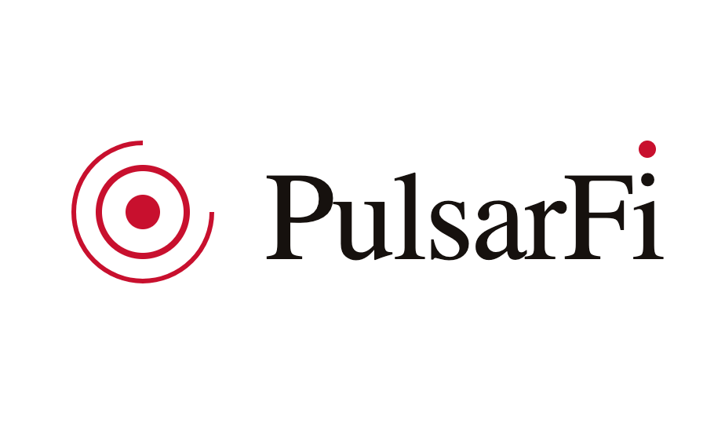
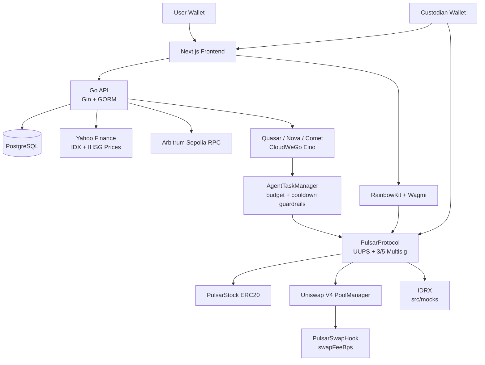
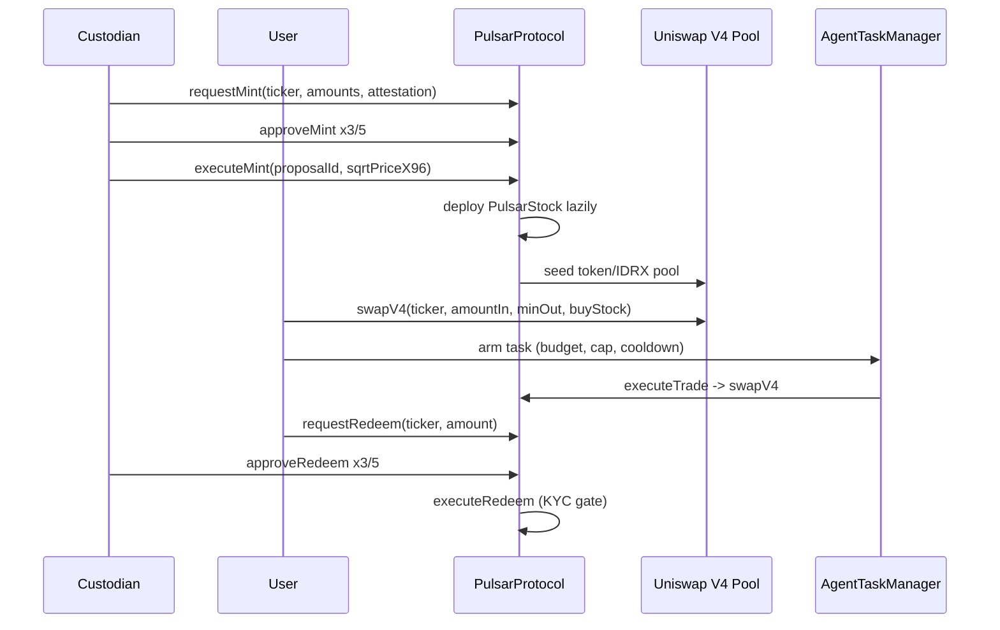

<div align="center">

# 

### Asset-backed Indonesian equity tokenization on Arbitrum Sepolia

[](https://soliditylang.org/)
[](https://book.getfoundry.sh/)
[](https://go.dev/)
[](https://nextjs.org/)
[](https://arbitrum.io/)

**PulsarFi turns selected IDX equities into 1:1 PulsarStock receipts with custodian attestations, IDRX settlement, Uniswap V4 liquidity, and an on-chain agent that trades under user-set guardrails.**

[Explore Docs](https://pulsarfi-docs.vercel.app) · [Frontend](./frontend) · [Backend](./backend) · [Smart Contracts](./smart-contract) · [Mobile App](https://github.com/hafidluqman50/pulsarfi-app)

Demo custodian wallets and the operator flow for judging are documented in [Judge Demo Access](https://pulsarfi-docs.vercel.app/docs/judge-demo-access). Custodian private keys are not published publicly; the trading flow remains self-serve with any Arbitrum Sepolia wallet.

<br/>


</div>

---

## Overview

**A Note on Development:** This project was built with strict architectural oversight. While AI tools were leveraged to accelerate development, every line of code was explicitly directed, reviewed, and deeply understood. There is no 'vibecoding' here. AI acts solely as a velocity multiplier for a deliberately engineered system.

PulsarFi tokenizes Indonesian public equities into `PulsarStock` tokens on Arbitrum Sepolia. Each token is an ERC-20 per IDX equity (`BUMIP`, `ENRGP`, `BRPTP`, …), backed 1:1 by shares held in custody at KSEI and paired against IDRX liquidity in a Uniswap V4 pool. Price discovery comes from the AMM, not an external oracle.

The product surface:

- **Markets** — browse tokenized equities, IDX prices, IHSG, and token detail pages.
- **Portfolio** — wallet holdings, transfers, swaps, and redemption requests.
- **Quasar** — the in-app agent: ask for analysis, charts, news, or a trade, and it either answers or prepares an on-chain task you arm yourself.
- **Custodian console** — mint proposals, reserve attestations, approvals, and redemption access.
- **Protocol** — mint, swap, and redeem through the contracts.

Holding and swapping are permissionless. KYC is enforced only at the redemption gateway, when a token is converted back to a physical security.

## Architecture



## Flow



## Agent system

Quasar (supervisor) talks to the user and routes work to Nova (analysis, charts, news) and Comet (execution). It runs on CloudWeGo Eino inside the Go backend; the model provider is selected by environment.

Trades are self-custodial: the user arms a `Task` on `AgentTaskManager` first. The contract enforces the guardrails on-chain — total budget, per-trade cap, and cooldown — and the agent can only ever submit within them. Nothing is delegated custody.

## Stack

| Layer | Technology |
|---|---|
| Frontend | Next.js 16, React, TailwindCSS, RainbowKit, Wagmi, React Query |
| Backend | Go, Gin, GORM, PostgreSQL, CloudWeGo Eino |
| Smart contracts | Solidity, Foundry, UUPS, OpenZeppelin, Uniswap V4 (PoolManager + hook) |
| Data | Yahoo Finance chart API, on-chain V4 pool, custodian attestations |
| Network | Arbitrum Sepolia |

## Repository

```text
frontend/        Next.js app for markets, portfolio, swap, Quasar, and custodian console
backend/         Go API for auth, market data, custodian workflows, and the agent
  src/app/core/agent/       agentcore: domain types and ports
  src/app/helper/           pure agent helpers
  src/config/               env, database, on-chain settings
  src/service/external/     chain, market data, storage, email
  src/service/agent/        orchestrator, chat, task, subtask, checkpoint, and the three roles
smart-contract/  Foundry project for PulsarProtocol, PulsarStock, AgentTaskManager
docs/            Docusaurus documentation source and implementation plans
```

## Quick Start

```bash
cd smart-contract
cp .env.example .env
forge build
forge test
```

```bash
cd backend
cp .env.example .env
go run main.go
```

```bash
cd frontend
npm install
npm run dev
```

## Docs

Full documentation lives at [pulsarfi-docs.vercel.app](https://pulsarfi-docs.vercel.app). Implementation plans and the agent flow map are in [`docs/plans/`](./docs/plans) and [`backend/src/service/agent/README.md`](./backend/src/service/agent/README.md).
