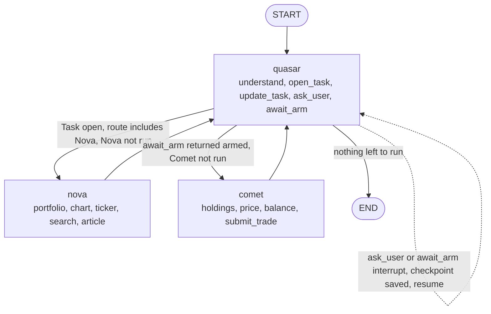

# Agent service

Map of the agent layer: who owns what, and where to look when a turn
misbehaves.

## One turn, end to end

```text
POST /agent/chats/:id/messages
 |
 +- chat.ChatService.HandleChatMessage            chat/chat_service.go
 |    resolveTurn       fresh | answer | side question | cancel
 |    persist the user message
 |    TurnRegistry      one turn per chat (core/turn_registry.go)
 |    runForMessage     detached from the request, 5-minute timeout
 |
 +- orchestrator.Orchestrator.Send                orchestrator/orchestrator_service.go
 |    dispatchTurn
 |      FreshTurn            -> runFreshTurn        graph checkpoint = chat id
 |      AnswerQuestions      -> resumeQuestionsTurn graph resumes the paused node
 |      SideQuestionDuringArm-> runSideTurn         own agent checkpoints, arm pause untouched
 |    invokeGraph                                 orchestrator/orchestrator_service.go
 |      graph: quasar -> nova -> quasar -> comet -> quasar   orchestrator/orchestrator_service.go
 |      every node reads its agent's events in readEvents    orchestrator/stream_service.go
 |    finish / finishInterrupt                    orchestrator/stream_service.go
 |      one pause  -> record the interrupt, keep the checkpoint
 |      no pause   -> clear checkpoint, persist the reply
 |
 +- chat persists the reply and publishes final / error
```

`ResumeExecute` (Arm Card) enters at `orchestrator_service.go`, resumes the
graph at the paused `quasar` node, and runs the same `invokeGraph` path.

## The graph



- Nodes are the three `adk.ChatModelAgent`s, each run by its own `adk.Runner`
  (`app/core/agent/agent_step.go` `AgentStep.Execute`, called through `orchestrator/orchestrator_service.go` `runAgentStep`). Quasar's tools write what they
  decide (`TaskID`, `Route`, `Armed`) into the `RunContext`; the node copies
  those plain fields into `agentcore.TurnState`, the only data that crosses nodes.
- The branch after `quasar` reads `TurnState` (`NeedsNova`, `NeedsComet`).
  Nova and Comet cannot run out of order; the order of Quasar's own tools inside
  one run is guarded by `understand` (route) and the `await_arm` refusal.
- A tool interrupt inside an agent becomes a graph interrupt: the node returns
  `compose.StatefulInterrupt` carrying the runner's interrupt id (`agentcore.AgentPause`);
  on resume the node reads it and calls `Runner.ResumeWithParams`.
- `await_arm` is a `ReturnDirectly` tool: once it returns, Quasar's run ends, so
  Comet executes before Quasar confirms. A refused `await_arm` ends that run too.

## Where a pause lives

| Thing | Owner |
|---|---|
| Is this chat paused, and on what? | `agentcore.InterruptStore` (`app/core/agent/interrupt_store.go`) |
| The interrupt bytes | `checkpoint.PostgresCheckPointStore` (`checkpoint/checkpoint_service.go`) |
| What the user answered | `orchestrator` resume path |

`ask_user` and `await_arm` are the only two interrupt sources; both are in
`supervisor/tools_service.go`. The marker records the graph's interrupt id.

## Ownership

| Path | Owns | Does not own |
|---|---|---|
| `app/core/agent` | domain types, ports, pause policy, turn guard, instructions | Postgres, chain, HTTP |
| `app/helper` | reply classification, Nova verdict parsing, graceful tool, string helpers | any state |
| `config/onchain.go` | reading and validating the five chain settings | calling the chain |
| `service/external/onchain_service.go` | every chain call (RPC, signer, AgentTaskManager) | chat/turn state |
| `service/agent/orchestrator` | graph, nodes, turn dispatch, resume, event stream, task workflow | chat persistence |
| `service/agent/chat` | chats, messages, turn intent, retry | prompt construction |
| `service/agent/task` | arm/disarm/pause/execute/reasoning, cooldown scheduler | LLM calls |
| `service/agent/subtask` | hash-chained sub-task rows (Postgres + chain port) | turn state |
| `service/agent/checkpoint` | Eino checkpoint persistence | pause policy |
| `supervisor` `analyzer` `executor` | the three agent roles and their tools | persistence, HTTP |

## Debugging recipes

| Symptom | Start here |
|---|---|
| Turn never finishes | `orchestrator/orchestrator_service.go` branch, `stream_service.go` `readEvents` + `finish` |
| Resume goes to the wrong place | `chat/chat_service.go` `resolveTurn`, then `InterruptStore.Pending` |
| "A turn is already running" | `agentcore.TurnRegistry` (`TryStart` / `Finish`) |
| No chart / wrong content type | `app/helper/reply_classifier.go` `ClassifyReply` |
| Nova verdict ignored | `app/helper/nova_verdict.go` `ParseNovaVerdict` |
| Tool failure swallowed | `app/helper/graceful_tool.go` (logs `tool=`, returns `tool_error`) |
| Sub-task chain broken | `subtask/recorder_service.go` `Record` |
| Pause survives a restart? | `checkpoint/checkpoint_service.go` |

Tests live in `backend/test/service/agent/` (per `AGENTS.md`).
