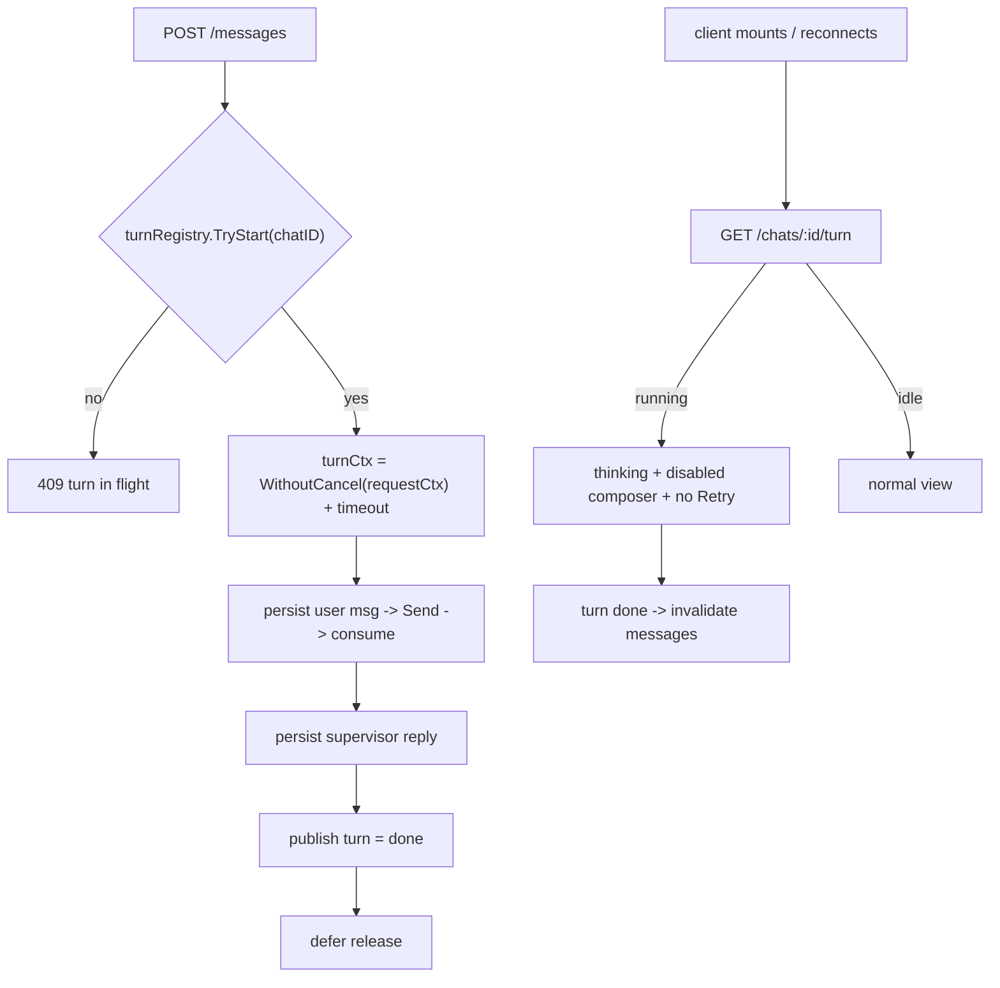

# Agent Chat Turn Lifecycle: Survive Navigation/Refresh, Never Duplicate

| | |
|---|---|
| **Version** | 1.1 |
| **Status** | Draft |
| **Date Created** | 2026-10-20 |
| **Last Updated** | 2026-10-20 |

| Version | Date | Change |
|---|---|---|
| 1.1 | 2026-10-20 | Aligned with the implementation: the `turn` events are published from `ChatService` (which owns the registry and the turn's start/end), not from `orchestrator_stream_service.go`; the registry type is exported (`TurnRegistry` / `NewTurnRegistry`) so `agent_registry.go` can construct it. Impacted-files row updated. |
| 1.0 | 2026-10-20 | Initial draft. |

## 1. Problem Statement

### 1.1 What the user sees

One request ("Cek Chart IHSG") produced **two** charts. The database shows why: one user row, **two** supervisor rows, each with its own Task.

```
1500 user        "Hmmm cek IHSG"                12:13:41
1501 supervisor  news + chart IHSG, Task 394    12:14:40   ← turn 1
1502 supervisor  news + chart IHSG, Task 395    12:15:30   ← turn 2
```

This is not a rendering bug: there are two distinct persisted messages. The same pattern exists in older chats (e.g. 6 user rows vs 11 supervisor rows), so it predates the recent work.

### 1.2 Two independent defects

**Defect A — the turn is owned by the HTTP request.**
`PostChatMessageHandler` passes `c.Request.Context()` into `HandleChatMessage` → `Orchestrator.Send` → every DB, LLM and chain call. A full refresh unloads the document, the browser aborts the XHR, Go cancels the request context, and the turn dies mid-flight; nothing survives or resumes it (`context.WithoutCancel` has zero hits in the backend). Client-side route navigation away from `/portfolio` unmounts `QuasarPanel` (mounted only in `app/portfolio/ui.tsx`), and `−` unmounts `ChatThread` — both discard every live-state field.

**Defect B — nothing knows a turn is in flight.**
`RetryLastMessage`'s only rule is "the last persisted row is a `user` row". While turn 1 is still running that remains true, so a retry starts a second turn concurrently. There is no per-chat lock, no in-flight marker, no status endpoint and no `AgentChat` field that can express "running".

The reported sequence is the two defects composing: send → close panel (client forgets, server keeps working) → reopen (UI sees only the user row, offers Retry) → retry starts a second turn → both finish.

## 2. Definition of Done

1. A turn completes when the client refreshes, closes the panel, or navigates to another route.
2. At most one turn runs per chat; a concurrent send or retry is rejected with `409`, not executed.
3. A client that mounts mid-turn (reload, route return, second tab) can tell a turn is running, shows that state, and never offers Retry meanwhile.
4. When the turn finishes, the persisted reply appears without a manual action, and exactly one supervisor row is written.
5. Menu switching, minimising the panel, and leaving/returning to `/portfolio` do not lose a running chat's live progress.
6. No change to SIWE / wallet connect behaviour.
7. Existing behaviour is otherwise unchanged: same events, persistence and on-chain calls.

## 3. Feature Description

**Backend — the server owns the turn.**
- A process-wide `turnRegistry` (mutex + `map[chatID]turnState`) is built once in `agent_registry.go` and injected into `ChatService`, the way `checkpointStore` already is.
- `HandleChatMessage` / `RetryLastMessage` call `TryStart(chatID)` first; failure returns `ErrTurnInFlight` → HTTP `409`. Success defers release.
- The turn runs on `context.WithoutCancel(ctx)` plus a per-turn timeout, so a disconnect no longer cancels it. The handler still blocks for a live client.
- `GET /api/v1/agent/chats/:id/turn` returns `{running, started_at}` after the usual ownership check — the authoritative answer for a client that has just mounted.
- The backend publishes a `turn` event (`running` | `done` | `failed`) on `agent-chat-stream:<chatId>` as a live signal only (the hub caches a single payload per topic, so state must come from the endpoint).

**Frontend — the live session outlives the component.**
- New module-level `chatSession` store keyed by `chatId`, owning the WS subscription and the live fields currently held in `ChatThread`.
- `ChatThread` becomes a view over the store; unmounting a component no longer drops the stream.
- On mount and on socket reconnect, it asks the turn status endpoint. `running` seeds the session as streaming (label, disabled composer, no Retry); `final` or a flipped status invalidates the messages query.
- Retry is offered only when the last message is the user's and no turn is running. The server `409` is the backstop.

## 4. Impacted Files

| Layer | Change | File | Reuse check |
|---|---|---|---|
| Backend | [NEW] | `backend/src/service/agent/turn_registry_service.go` | Mirrors how `PostgresCheckPointStore` is built once and shared |
| Backend | [MODIFY] | `backend/src/service/agent/chat_service.go` | Guard, `ErrTurnInFlight`, detached turn context, `TurnStatus`, `turn` event publishing |
| Backend | [MODIFY] | `backend/src/service/agent_registry.go` | Build and inject the registry |
| Backend | [MODIFY] | `backend/src/http/handlers/agent/chats.go` | Map `ErrTurnInFlight` → 409 |
| Backend | [NEW] | `backend/src/http/handlers/agent/turn.go` | `GET /chats/:id/turn` |
| Backend | [MODIFY] | `backend/src/http/routes/agent/router.go` | Register the route |
| Frontend | [NEW] | `frontend/components/agent/chatSession.ts` | Small module-level store; the app has no state library |
| Frontend | [MODIFY] | `frontend/components/agent/ChatThread.tsx` | Read live state from the store; status probe; retry gating |
| Frontend | [MODIFY] | `frontend/http/agent/chatApi.ts` | `getTurnStatus`, `turn` event, 409 handling |
| Tests | [NEW] | `backend/test/service/agent/turn_registry_test.go` | Registry + detached context units |

Not touched: `SiweAuthContext`, `providers.tsx`, wagmi/RainbowKit, the realtime hub, the DB schema.

## 5. Code Shape

### 5.1 `turn_registry_service.go` [NEW]

```go
type turnState struct{ startedAt time.Time }

type TurnRegistry struct {
    mu     sync.Mutex
    active map[uuid.UUID]turnState
}

func NewTurnRegistry() *TurnRegistry
func (r *TurnRegistry) TryStart(chatID uuid.UUID) (release func(), ok bool)
func (r *TurnRegistry) Status(chatID uuid.UUID) (running bool, startedAt time.Time)
```

`TryStart` returns `ok=false` when the chat already has an entry; `release` is idempotent.

### 5.2 `chat_service.go`

```go
var ErrTurnInFlight = errors.New("agent: a turn is already running for this chat")

func (s *ChatService) HandleChatMessage(ctx, chatID, wallet, message string, hidden bool) (WorkflowCard, error) {
    release, ok := s.Turns.TryStart(chatID)
    if !ok {
        return WorkflowCard{}, ErrTurnInFlight
    }
    defer release()

    turnCtx, cancel := context.WithTimeout(context.WithoutCancel(ctx), turnTimeout)
    defer cancel()
    return s.handleChatMessage(turnCtx, chatID, wallet, message, hidden)
}
```

`RetryLastMessage` gets the same guard and detached context; its body moves to `retryLastMessage`.

### 5.3 `turn.go` [NEW] + route

```go
func GetTurnStatusHandler(c *gin.Context) {
    // parse chatID + wallet, ownership via ChatService.TurnStatus
    response.OK(c, "turn status", gin.H{"running": running, "started_at": startedAt})
}
```

### 5.4 `chats.go`

```go
case errors.Is(err, agentsvc.ErrTurnInFlight):
    response.Conflict(c, "a turn is already running for this chat")
```

### 5.5 `chatSession.ts` [NEW]

```ts
export type ChatSession = {
  running: boolean;
  liveSubTasks: LiveSubTask[];
  toolActivityByAgent: Record<string, string>;
  thinkingByAgent: Record<string, string>;
  streamingReplyText: string;
  isFinalizing: boolean;
  chartPending: boolean;
  failedMessage: { text: string; description: string } | null;
};

export function subscribeChatSession(chatId: string, listener: () => void): () => void
export function getChatSession(chatId: string): ChatSession
export function markTurnStarted(chatId: string): void
export function markTurnEnded(chatId: string): void
export function setChatSession(chatId: string, patch: Partial<ChatSession>): void
```

The store subscribes through `realtimeSocket` on the first listener for a chat and unsubscribes when the last one leaves. `running` replaces `isStreaming` as the render gate.

### 5.6 `ChatThread.tsx`

- Live fields come from `useChatSession(chatId)` (`useSyncExternalStore`).
- On mount: `getTurnStatus(chatId)` → `running` seeds started; on `turn` `done|failed`, invalidate `['agent-chat-messages', chatId]`.
- `needsRetry` gains `&& !session.running`; the composer uses `session.running || pendingText != null`.

## 6. UI/UX Changes (Lo-Fi)

```
REFRESH MID-TURN
BEFORE  reload -> nothing running locally -> Retry offered -> second turn -> two charts
AFTER   reload -> GET /chats/:id/turn says running
        -> "Quasar is thinking" + composer disabled + no Retry
        -> final arrives -> one reply, one chart

NAVIGATION / MINIMISE
AFTER   the running chat keeps its live state in the session store;
        returning re-attaches the view with no reconnect dance.
```

## 7. Flowchart



## 8. Verification Plan

### Automated
1. `cd backend && go build ./... && go vet ./...` — clean.
2. `go test ./test/service/agent/ -run TestTurnRegistry -race` — `TryStart` rejects the second caller, `release` is idempotent, `Status` reflects the entry.
3. `go test ./test/service/agent/ -run TestTurnContextSurvivesCancellation -race` — `WithoutCancel` derived context stays alive after the parent is cancelled and is bounded by its own timeout.
4. `go test ./test/service/agent/ -run TestChatRetry_ScopesToTheChatsOwnLastMessage -race` — still green.
5. `cd frontend && npx tsc --noEmit && npx eslint components/agent/ChatThread.tsx` — clean.

### Manual
1. Send "Cek Chart IHSG", refresh mid-turn → the turn finishes; one supervisor row, one chart; no 500.
2. Send, close/reopen the panel mid-turn → running state still shown; no Retry.
3. Send, navigate to `/stocks` and back → the reply appears once.
4. Retry while running (second tab) → `409`, no second supervisor row.
5. DB check: one user row, one supervisor row, one Task per request.

## 9. Decisions & Trade-offs

- **In-process registry, not a DB lock.** The backend ships as one container (`backend/Dockerfile`, no replicas); an in-process map is correct and free. A DB lease is the multi-instance upgrade path — not `pg_advisory_lock`, which holds a pooled connection for the whole turn.
- **`WithoutCancel`, not a job queue.** Solves refresh/navigation with no new infrastructure. A durable queue would also survive process restarts, which is not the problem being fixed.
- **Client session store, not relocating the panel.** Fixes menu/minimise/route loss without changing where the panel appears.
- **`turn` event is a live signal only**; the status endpoint is the source of truth.
- **Partial stream loss is accepted.** Streamed text before a mid-turn remount cannot be reconstructed; the final persisted reply supersedes it. Sub-tasks recover from the next full snapshot.
- **Out of scope:** the `agent-chat-stream:<id>` topic allows any authenticated wallet without checking chat ownership; a process restart mid-turn leaves the user row without a reply (recoverable via Retry); the separately reported "double SIWE" issue.
