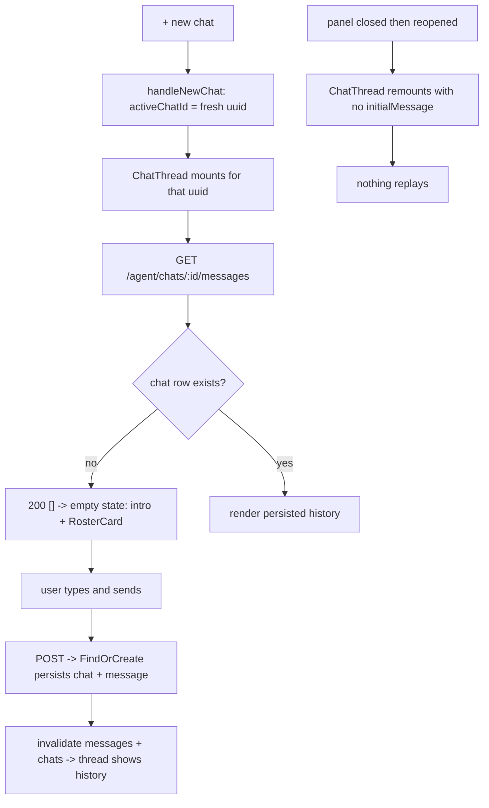

# Agent New-Chat Model Simplification

| | |
|---|---|
| **Version** | 1.1 |
| **Status** | Draft |
| **Date Created** | 2026-10-20 |
| **Last Updated** | 2026-10-20 |

| Version | Date | Change |
|---|---|---|
| 1.1 | 2026-10-20 | Added the regression test for the idempotent read (§4, §8): `chat_service_test.go` asserts `GetChatMessages` returns an empty slice with a nil error for a chat that has no row, and that a wallet mismatch on an existing chat still returns `ErrWalletMismatch`. Rationale: the not-found branch is the change that makes mounting a fresh chat cheap, so it is worth a test of its own rather than being covered implicitly. |
| 1.0 | 2026-10-20 | Initial draft. |

## 1. Problem Statement

The Quasar panel models one concept — "the chat the user is looking at" — with four states: `activeChatId`, `pendingNewChatId`, `pendingDraft` and `initialMessageForActiveChat`.

`+ new chat` cannot set `activeChatId` directly, because a mounted `ChatThread` immediately runs `useChatMessages(chatId)`, and a brand-new chat has no row yet — `ChatService.GetChatMessages` calls `Chats.FindByID`, which returns `ErrChatNotFound`, and the handler answers `500`. So the panel keeps `activeChatId` null, stores a `pendingNewChatId`, and renders the "welcome" view (intro banner + `RosterCard` + its own composer) itself. On the first send it promotes `pendingNewChatId` to `activeChatId` and hands the typed text to `ChatThread` through `initialMessageForActiveChat`.

That hand-off is the defect:

- `initialMessageForActiveChat` is set once, in `handleSendPending`, and **never cleared** — not by `handleNewChat`, not by `handleSelectChat`, not after the send settles.
- `ChatThread` fires it from a mount effect guarded only by a per-instance `useRef` (`hasSentInitialMessageRef`); a remount creates a fresh ref.
- The `−` button (`setExpanded(false)`) unmounts `ChatThread` but not `QuasarPanelContent`, whose state survives.

Reproduction: a chat fails → `+ new chat` → close the panel → reopen → the stale `initialMessage` is re-sent into the new chat, and because `initialMessage` is non-null the remounted thread also starts with `messagesQueryEnabled = false`, hiding the real history until the spurious send settles. This is the reported duplication. (Related: `docs/plans/fix-new-chat-lazy-mount.md` introduced the lazy-mount design this supersedes.)

## 2. Definition of Done

1. `handleNewChat` sets `activeChatId` to a fresh `crypto.randomUUID()`; no `pendingNewChatId`, `pendingDraft`, `initialMessageForActiveChat` or `handleSendPending` remains.
2. `ChatThread` takes only `chatId`; the messages query is always enabled.
3. The intro banner + `<RosterCard />` render as `ChatThread`'s own empty state: no messages, not streaming, no pending bubble.
4. `GET /agent/chats/:id/messages` returns `200 []` when the chat has no row yet; it never answers `500` for that reason.
5. Closing and reopening the panel never replays a previous message — the duplicate cannot occur.
6. `+ new chat` shows the intro + `RosterCard` inside the thread, with no console or network error.
7. A brand-new chat shows up in History once its first message has been sent.

## 3. Feature Description

`activeChatId` becomes the single source of truth for "which chat is open". `+ new chat` sets it to a fresh UUID, so the keyed `ChatThread` mounts for it immediately. Because a chat with no row yet now legitimately reads as an empty message list, mounting costs nothing worse than one small `GET` that returns `[]`. `ChatThread` renders the intro/RosterCard itself while it has no messages, so the panel no longer needs a second "welcome" branch or any cross-component message hand-off. On mount while the user has no chats at all, the auto-select effect starts one.

Objective: with no hand-off value and no second chat state, the cross-chat replay has no mechanism left.

## 4. Impacted Files

Paths are under `frontend/` and `backend/`. No new source file is added.

| Layer | Change | File | Reuse check |
|---|---|---|---|
| Frontend | [MODIFY] | `frontend/components/agent/QuasarPanel.tsx` | Owns `activeChatId`, the auto-select effect and the new-chat button |
| Frontend | [MODIFY] | `frontend/components/agent/ChatThread.tsx` | Already owns the message list and its empty rendering |
| Backend | [MODIFY] | `backend/src/service/agent/chat_service.go` | `GetChatMessages` already exists; only its not-found branch changes |
| Tests | [MODIFY] | `backend/test/service/agent/chat_service_test.go` | Already covers `GetChatMessages` (happy path + wallet mismatch); the idempotent-read case is added beside them |

Frontend has no test harness for `ChatThread`/`QuasarPanel`; those are verified manually plus `tsc`/`eslint`.

## 5. Code Shape

### 5.1 `QuasarPanel.tsx`

```tsx
// BEFORE
const [pendingNewChatId, setPendingNewChatId] = useState<string | null>(null);
const [pendingDraft, setPendingDraft] = useState('');
const [initialMessageForActiveChat, setInitialMessageForActiveChat] = useState<string | null>(null);

useEffect(() => {
  if (activeChatId || pendingNewChatId || chats.length === 0) return;
  setActiveChatId(chats[0].id);
}, [chats, activeChatId, pendingNewChatId]);

function handleNewChat() {
  setActiveChatId(null);
  setPendingNewChatId(crypto.randomUUID());
  setPendingDraft('');
  setActiveTaskId(null);
  setDestination('chat');
}
function handleSelectChat(chatId: string) {
  setPendingNewChatId(null);
  setPendingDraft('');
  setActiveChatId(chatId);
  setDestination('chat');
}
function handleSendPending() { /* ... setInitialMessageForActiveChat(trimmed); setActiveChatId(target); ... */ }

// JSX: {!activeChatId && (<>{welcome banner}{<RosterCard />}{composer bound to pendingDraft}</>)}
// JSX: <ChatThread key={activeChatId} chatId={activeChatId} initialMessage={initialMessageForActiveChat ?? undefined} />
```

```tsx
// AFTER
const { data: chats = [], isSuccess: chatsLoaded } = useAgentChats();

useEffect(() => {
  if (activeChatId || !chatsLoaded) return;                              // decide only once the list is known
  setActiveChatId(chats.length > 0 ? chats[0].id : crypto.randomUUID()); // newest chat, or start fresh
}, [chats, chatsLoaded, activeChatId]);

function handleNewChat() {
  setActiveChatId(crypto.randomUUID());
  setActiveTaskId(null);
  setDestination('chat');
}
function handleSelectChat(chatId: string) {
  setActiveChatId(chatId);
  setDestination('chat');
}

// JSX: keep a minimal !activeChatId fallback (intro banner + <RosterCard />, no composer)
//       so the single frame before the effect runs does not flash empty.
// JSX: <ChatThread key={activeChatId} chatId={activeChatId} />
```

Deleted symbols: `pendingNewChatId`, `pendingDraft`, `initialMessageForActiveChat`, `handleSendPending`, the `!activeChatId` welcome/composer block.

### 5.2 `ChatThread.tsx`

```tsx
// BEFORE
type ChatThreadProps = { chatId: string; initialMessage?: string };
const [messagesQueryEnabled, setMessagesQueryEnabled] = useState(!initialMessage);
const { data: messages = [], isLoading } = useChatMessages(chatId, { enabled: messagesQueryEnabled });

const hasSentInitialMessageRef = useRef(false);
useEffect(() => {
  if (initialMessage && !hasSentInitialMessageRef.current) {
    hasSentInitialMessageRef.current = true;
    handleSend(initialMessage);
  }
}, []);
```

```tsx
// AFTER
type ChatThreadProps = { chatId: string };
const { data: messages = [], isLoading } = useChatMessages(chatId);   // always enabled

// NEW — intro as the thread's own empty state, rendered inside MessageList when
//       messages.length === 0 && !isStreaming && !pendingText:
<>
  {/* intro banner, same visual as the removed panel banner */}
  <RosterCard />
</>
```

- The `setMessagesQueryEnabled(true)` line in `handleSend` is removed.
- `handleSend`'s success path also invalidates `['agent-chats']` so a brand-new chat appears in History.

Deleted symbols: `initialMessage` prop, `messagesQueryEnabled`, `hasSentInitialMessageRef` and its effect.

### 5.3 `chat_service.go`

```go
// BEFORE
func (s *ChatService) GetChatMessages(ctx context.Context, chatID uuid.UUID, wallet string) ([]model.AgentChatMessage, error) {
    _, messages, err := s.GetChat(ctx, chatID, wallet)
    return messages, err
}
```

```go
// AFTER
func (s *ChatService) GetChatMessages(ctx context.Context, chatID uuid.UUID, wallet string) ([]model.AgentChatMessage, error) {
    _, messages, err := s.GetChat(ctx, chatID, wallet)
    if errors.Is(err, ErrChatNotFound) {
        return []model.AgentChatMessage{}, nil // idempotent read: no row yet == no messages
    }
    return messages, err
}
```

`GetChat` stays strict — a wallet mismatch on an existing chat still errors. The `chats.go` handler is unchanged.

### 5.4 `chat_service_test.go` [MODIFY] — idempotent-read regression

```go
// 4. A chat with no row yet reads as an empty list, not an error (idempotent read).
unknownID := uuid.New()
empty, err := registry.AgentChat.GetChatMessages(ctx, unknownID, testWallet)
if err != nil {
    t.Fatalf("expected nil error for an unknown chat, got %v", err)
}
if len(empty) != 0 {
    t.Fatalf("expected 0 messages, got %d", len(empty))
}
```

The existing wallet-mismatch assertion in the same test (`ErrWalletMismatch` on an existing chat) is kept as-is and guards that the not-found branch did not loosen ownership.

## 6. UI/UX Changes (Lo-Fi)

```
NEW CHAT — BEFORE
[Quasar]  [+ new chat]  [menu]  [−]
──────────────────────────────────────
  I am Quasar. Write the instruction in your own words …
  [ RosterCard: Quasar / Nova / Comet ]
                          (panel-owned welcome view; pendingNewChatId)
[ textarea ............... ] [ Send ]

  ⋯ panel closed, then reopened ⋯
  ChatThread remounts with the STALE initialMessage
  → the previous message is sent again into the new chat (duplicate)

NEW CHAT — AFTER
[Quasar]  [+ new chat]  [menu]  [−]
──────────────────────────────────────
  I am Quasar. Write the instruction in your own words …
  [ RosterCard: Quasar / Nova / Comet ]
                          (ChatThread's own empty state)
[ textarea ............... ] [ Send ]

  ⋯ panel closed, then reopened ⋯
  ChatThread remounts with no hand-off → nothing replays
```

## 7. Flowchart



## 8. Verification Plan

### Automated
1. `cd frontend && npx tsc --noEmit` — clean.
2. `cd frontend && npm run lint` — clean.
3. `cd backend && go build ./... && go vet ./...` — clean.
4. `cd backend && go test ./test/service/agent/ -run TestChatServiceDecomposition -race` — with `DATABASE_URL` set, the extended test passes: the unknown-chat read returns an empty slice with a nil error, and the wallet-mismatch case still returns `ErrWalletMismatch`. (Without `DATABASE_URL` the test skips; that is the existing behavior of every test in this package.)
5. `grep -rn "initialMessage\|pendingNewChatId\|pendingDraft" frontend/` — no matches left.

### Manual
1. Open the panel, click `+ new chat`: the intro + `RosterCard` appear inside the thread; Network shows one `GET …/messages` returning `200 []` (no 500) in the console or backend log.
2. Type a message and send: bubbles appear, the chat is persisted, and it appears in History.
3. Force a failure (e.g. stop the backend mid-send), then `+ new chat`, close the panel (`−`), reopen: no message from the previous chat is replayed, and the real history is visible.
4. With zero chats, open the panel: it starts a fresh chat automatically.
5. Select a chat from History: its persisted history loads immediately.
