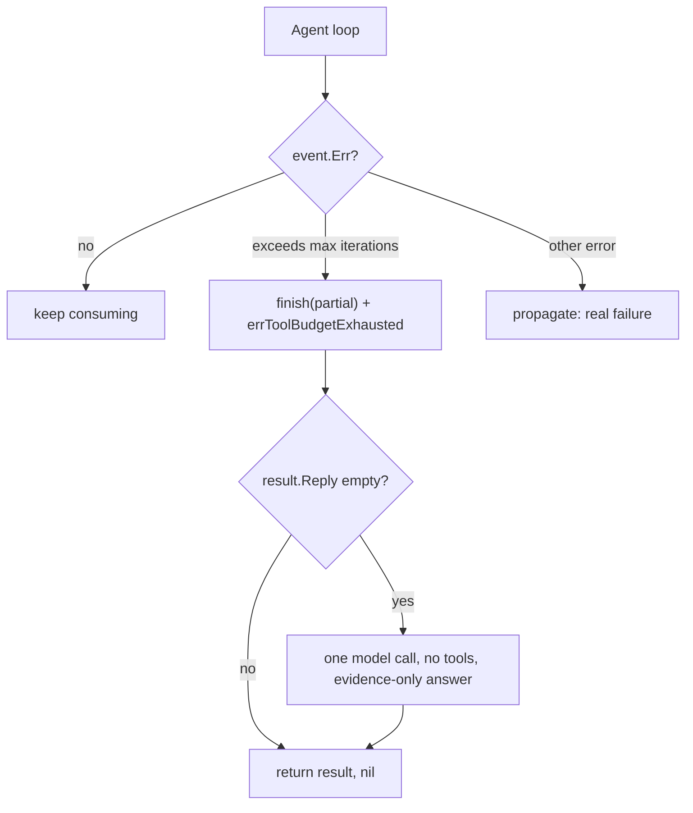

# Agent Tool-Budget Truncation

| | |
|---|---|
| **Version** | 1.1 |
| **Status** | Implemented |
| **Date Created** | 2026-10-20 |
| **Last Updated** | 2026-10-21 |

| Version | Date | Change |
|---|---|---|
| 1.1 | 2026-10-21 | Marked Implemented: the plan shipped in #51. |
| 1.0 | 2026-10-20 | Initial draft. |

## 1. Problem Statement

`adk.ChatModelAgent` bounds its `ChatModel ↔ ToolNode` loop with `MaxIterations`: Nova (`analyzer_agent`) is capped at 8, Comet at 10, Quasar at 12. When an agent spends the whole budget calling tools without writing a final answer, Eino returns `adk.ErrExceedMaxIterations` ("exceeds max iterations").

That error is currently **unhandled**: `Orchestrator.consume` returns it, `ChatService.runForMessage` wraps it, and the HTTP handler answers `500 {"message":"Failed to process chat message"}`. Observed live on a news query (`TestLiveNewsQueryHTTPEndpoint`): Nova kept searching/reading articles, hit the 8-iteration cap, and the whole chat turn failed — even though the same prompt succeeded in a sibling test in the same run.

Evidence that this is a budget problem, not a broken tool:

- The graceful tool wrapper logs `agent: tool call failed, degrading gracefully` on any tool error; that log line is **absent** for the failing turn.
- The failure is non-deterministic: `"Check berita IHSG hari ini dong"` passed in `TestLiveNewsQueryEndpoint` (85s) and hit the cap in `TestLiveNewsQueryHTTPEndpoint` in the same run.
- A prior fix (#36) added "catch exceeds max iterations gracefully"; the handling was lost in the later orchestrator refactor (no reference to the sentinel remains in `src/`).

The maintainer's decision: **keep the budget at 8** — do not raise it. A turn that runs out of tool budget must still finish, with whatever evidence it has, instead of failing.

## 2. Definition of Done

1. `adk.ErrExceedMaxIterations` (wrapped or bare) never escapes `Orchestrator.Send` or `Orchestrator.ResumeExecute`.
2. When the budget is exhausted, the turn finishes normally: `Send` returns `(result, nil)` and the plan's classification (`classifyReply`) still runs.
3. If the agent already wrote some reply text, that text is kept. If it wrote none, the model is asked **once**, with no tools, to answer from the evidence it has — never a hardcoded sentence, and the reply stays in the user's language.
4. The fallback final answer is published as a `reply_delta` so a subscribed client sees it.
5. `MaxIterations` stays 8 / 10 / 12 — unchanged.
6. Everything else is unchanged: same events, same persistence, same on-chain calls.

## 3. Feature Description

A tool-call budget is a budget, not an error. When an agent reaches it, the orchestrator stops the event loop and finalizes the turn from what it already collected. If the agent produced no text at all (for example Nova exhausting its budget inside `analyzer_agent`), one extra model call — without tools — asks Quasar to answer from the gathered evidence and to be honest about anything it could not verify. The user gets an answer either way; the request never 500s.

## 4. Impacted Files

| Layer | Change | File | Reuse check |
|---|---|---|---|
| Backend | [MODIFY] | `backend/src/service/agent/orchestrator_service.go` | Owns `Send`, `ResumeExecute` and the package's error vars; gains the sentinel and the forced final answer |
| Backend | [MODIFY] | `backend/src/service/agent/orchestrator_stream_service.go` | Owns `consume`, the one loop that sees `event.Err` |
| Tests | [NEW] | `backend/test/service/agent/tool_budget_test.go` | Offline: a scripted agent capped at 1 iteration that only ever calls a tool |

No new package, table, dependency or frontend change. `MaxIterations` constants are untouched.

## 5. Code Shape

### 5.1 `orchestrator_stream_service.go`

```go
// errToolBudgetExhausted is not a failure to report: the agent used its whole
// tool-call budget without writing a final answer. consume returns it together
// with the partial result so Send can finish the turn instead of failing it.
var errToolBudgetExhausted = errors.New("agent: tool budget exhausted")

func isToolBudgetExhausted(err error) bool {
    if err == nil {
        return false
    }
    return errors.Is(err, adk.ErrExceedMaxIterations) ||
        strings.Contains(err.Error(), adk.ErrExceedMaxIterations.Error())
}
```

```go
// BEFORE — consume
if event.Err != nil {
    return OrchestratorResult{}, event.Err
}

// AFTER
if event.Err != nil {
    if isToolBudgetExhausted(event.Err) {
        // The cap is a budget, not an error: keep whatever the turn produced
        // and let Send finalize it.
        return o.finish(ctx, rc, &outcome, keepCheckpoint), errToolBudgetExhausted
    }
    return OrchestratorResult{}, event.Err
}
```

### 5.2 `orchestrator_service.go`

```go
const finalAnswerTimeout = 30 * time.Second

const toolBudgetInstructions = `You have reached your tool-call budget for this turn. Answer the user now using only the evidence you already have: do not call any more tools. Be honest about anything you could not verify. Reply in the same language as the user's message.`
```

```go
// BEFORE — Send
pending, hasPending := o.pending(ctx, in.ChatID)
if hasPending && pending.kind == interruptQuestions {
    ...
    return o.consume(ctx, rc, iter, false)
}
iter := o.runner.Run(...)
return o.consume(ctx, rc, iter, hasPending && pending.kind == interruptArm)

// AFTER
result, err := o.runTurn(ctx, rc, in)
if errors.Is(err, errToolBudgetExhausted) {
    o.finishOnBudget(ctx, in, &result)
    return result, nil
}
return result, err
```

```go
// resumeQuestionsTurn / runFreshTurn keep their bodies; runTurn is the old
// inline dispatch, unchanged in order and arguments.
func (o *Orchestrator) runTurn(ctx context.Context, rc *RunContext, in OrchestratorInput) (OrchestratorResult, error)
```

```go
// finishOnBudget turns a budget-exhausted turn into a normal one. It keeps the
// agent's own text when there is any; otherwise it asks the model once, with no
// tools, for an answer from the evidence already gathered. No hardcoded reply
// is written here.
func (o *Orchestrator) finishOnBudget(ctx context.Context, in OrchestratorInput, result *OrchestratorResult) {
    if strings.TrimSpace(result.Reply) != "" || o.ReplyModel == nil {
        return
    }
    ctx, cancel := context.WithTimeout(ctx, finalAnswerTimeout)
    defer cancel()
    messages := append([]*schema.Message{schema.SystemMessage(toolBudgetInstructions)}, in.Messages...)
    resp, err := o.ReplyModel.Generate(ctx, messages)
    if err != nil || resp == nil || strings.TrimSpace(resp.Content) == "" {
        return
    }
    result.Reply = strings.TrimSpace(resp.Content)
    PublishChatEvent(in.ChatID, "reply_delta", map[string]any{"delta": result.Reply})
}
```

`ResumeExecute` gets the same guard:

```go
result, err := o.consume(ctx, rc, iter, false)
if errors.Is(err, errToolBudgetExhausted) {
    return ExecuteTaskResult{TaskID: taskID, Status: "executed", Reply: result.Reply}, nil
}
if err != nil {
    return ExecuteTaskResult{}, fmt.Errorf("orchestrator: resume execute failed: %w", err)
}
```

## 6. UI/UX Changes (Lo-Fi)

```
BEFORE — Nova spends its 8 tool calls on news research
  user: "Check berita IHSG hari ini dong"
  → HTTP 500 {"message":"Failed to process chat message"}
  → chat shows the error state

AFTER
  user: "Check berita IHSG hari ini dong"
  → HTTP 200, Quasar answers from the evidence gathered so far
     ("here is what I found, and what I could not verify")
```

No new UI element; only the existing reply bubble.

## 7. Flowchart



## 8. Verification Plan

### Automated
1. `cd backend && go build ./... && go vet ./...` — clean.
2. `go test ./test/service/agent/ -run 'TestToolBudget' -race` — offline: a scripted agent capped at 1 iteration that always calls a tool returns a finalized result and a **nil** error, never `ErrExceedMaxIterations`; the forced final answer is used when the agent wrote nothing.
3. Existing offline suites stay green.
4. Live: `go test ./test/service/agent/ -run 'TestLiveNewsQueryHTTPEndpoint' -timeout 300s` — the query that used to 500 now answers 200 (subject to the provider being reachable).

### Notes
- `MaxIterations` is deliberately unchanged (8 / 10 / 12).
- The forced final answer names no language; the model mirrors the user's.
