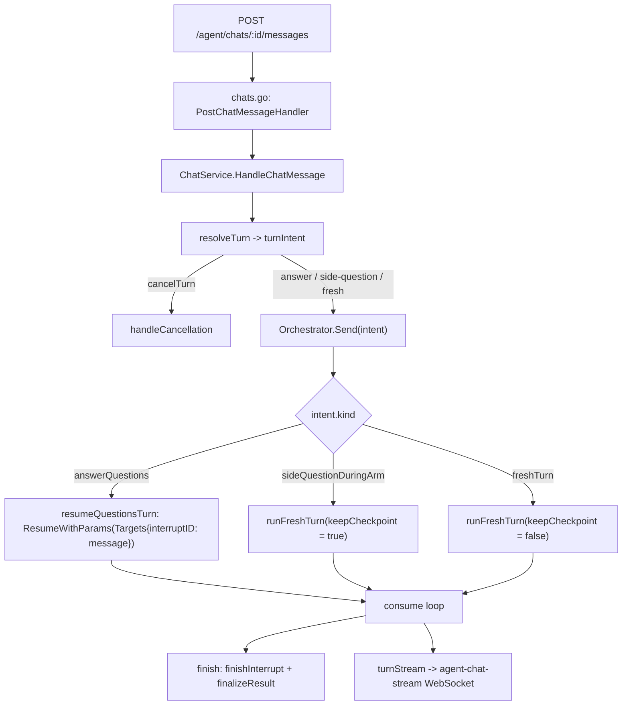

# Agent Turn Pipeline Refactor

| | |
|---|---|
| **Version** | 1.2 |
| **Status** | Draft |
| **Date Created** | 2026-10-20 |
| **Last Updated** | 2026-10-20 |

| Version | Date | Change |
|---|---|---|
| 1.2 | 2026-10-20 | Re-applied on top of the newer `main` (new-chat model, tool-budget truncation, turn lifecycle). The resolution keeps those behaviours: `Send`/`ResumeExecute` still finalize a budget-exhausted turn, and `ChatService` still takes the per-chat turn slot and runs the turn on a detached context. Added `FreshTurnIntent()` because `Send` now takes a `turnIntent` and one test drives it directly. |
| 1.0 | 2026-10-20 | Initial draft. |

## 1. Problem Statement

A reader following one chat message from the HTTP handler to the streamed reply could not tell, from any single place, (a) where the message goes, (b) what will make the turn pause on an interrupt, or (c) where an answer to that pause is handled. The routing was implicit — `Orchestrator.Send` compared `pending.kind` inline — the interrupt is raised deep inside a tool, and the streaming wiring was spread across four files. Short receivers (`o`, `rc`) and abbreviated locals (`iter`) compounded it.

This plan makes the pipeline legible **without changing observable behavior**: same messages persisted, same sub-tasks recorded, same on-chain calls, same events on the wire.

### 1.1 The flow



Reading map (also a header comment on `orchestrator_service.go`):

- A message arrives at `ChatService.HandleChatMessage`, which calls **`resolveTurn`** — the single place that asks "given this chat's pending interrupt, what is this message?". It reads the pending marker (`agent_checkpoints`, key `interrupt_id:<chatID>`, value `"<kind>|<id>"`) exactly once.
- `Orchestrator.Send` switches on the resolved intent: `answerQuestions` resumes the paused turn targeting the interrupt id; `sideQuestionDuringArm` starts a new turn with `keepCheckpoint = true` so the Arm pause survives; `freshTurn` starts a new turn with `keepCheckpoint = false`.
- **What raises an interrupt** (mid-turn, from the model's own tool choice — the backend does not predict it): `ask_user` calls `tool.StatefulInterrupt` with `QuestionsInterrupt` (`supervisor/tools_service.go`); `await_arm` calls it with `ArmInterrupt`. The stream then emits `event.Action.Interrupted` → `interruptFrom()` → `finishInterrupt` records the marker.
- **Where an answer is handled**: the same suspended tool reads it via `tool.GetResumeContext[string](ctx)`; `await_arm` returns `"armed"`. The Arm is answered through `POST /agent/tasks/:id/execute` → `Orchestrator.ResumeExecute`, never through chat.

### 1.2 Findings addressed

| # | Finding |
|---|---|
| 1 | The HTTP handler published WS events (`final`/`error`) and duplicated the error string; `runAgentOverSocket` was misleadingly named (a blocking HTTP request, not a socket). |
| 2 | `ChatService`'s doc claimed it "never builds LLM prompts", but `generateCancellationReply` built one. |
| 3 | Two different "chat paused?" notions (`CheckPointStore.Has` vs `GetInterruptID`). |
| 4 | Cancellation was a special path spread across layers. |
| 5 | `Send` was three things at once, with a `keepCheckpoint` bool smuggled into `consume`. |
| 6 | `finish` mixed streaming with persistence/classification. |
| 7 | `RunContext` packed four lifetimes (identity, persistence, UI callbacks, transient attribution, plus a private `live`). |
| 8 | `newRunContext` / `restore*` lived in the workflow file. |
| 9 | Streaming wiring spanned four files. |
| 10 | Short receivers and ambiguous locals. |

## 2. Definition of Done

1. One named decision point (`ChatService.resolveTurn` → `turnIntent`) says what a message is; `Send` switches on it instead of re-reading the pending marker.
2. One owner for the per-turn live stream (`turnStream`); `RunContext` carries identity + persistence + a single `Stream` field.
3. The HTTP handler publishes no WS event; it maps errors to HTTP only.
4. A single `interruptStore` answers "is this chat paused" for both `ChatService` and `Orchestrator`.
5. `ChatService` matches its doc comment (no LLM prompt building).
6. `Send`, `finish` and the run-context builders read as a linear pipeline.
7. Destructive check: `go build`, `go vet`, and the offline agent tests pass; observable outputs are unchanged.

## 3. Feature Description

- **`turnIntent` / `resolveTurn`** (C0): `turnKind` is `freshTurn`, `answerQuestions`, `sideQuestionDuringArm`, `cancelTurn`; `turnIntent` carries the kind plus the `interruptID` to answer. `resolveTurn` reads the pending marker once.
- **`turnStream`** (C1): owns `liveSubTasks` plus `StepStarted`/`SetCurrent`/`StepFailed`/`StepDone`; `RunContext` keeps `Stream *turnStream` and drops `OnSubTaskStarted`, `OnSubTaskFailed`, `CurrentAgent`, `CurrentStepName`, the private `live`, and the dead `Locale`.
- **Run-context builders** (C2) moved into `run_context_service.go`.
- **Terminal events** (C3) moved from the handler into the service (`runForMessage`).
- **`interruptStore`** (C4): one `pending`/`record`/`isPaused`/`clear`, reached identically by both types.
- **Cancellation reply** (C5) moved to the orchestrator, which already owns `ReplyModel`.
- **`Send`/`finish`** (C6) flattened.
- **Naming** (C7): `orch`/`svc`/`run`/`live`, `events`.
- **Flow map + comments** (C8): the §1.1 map plus header comments.

## 4. Impacted Files

| Layer | Change | File | Reuse check |
|---|---|---|---|
| Backend | [MODIFY] | `backend/src/http/handlers/agent/chats.go` | `runAgentOverSocket` → `respondWithTurn`; its `PublishChatEvent` calls and `chatID` param removed; `log/slog` import dropped |
| Backend | [MODIFY] | `backend/src/service/agent/chat_service.go` | Adds `turnKind`/`turnIntent`/`resolveTurn`/`lastUserMessage`; publishes the terminal event; cancellation calls the orchestrator; receiver `s` → `svc` |
| Backend | [MODIFY] | `backend/src/service/agent/orchestrator_service.go` | `Send(intent)` + `resumeQuestionsTurn`/`runFreshTurn`; `CancellationReply`; `resolveChatID` → `chatIDForTask`; `pending`/`storeInterrupt` removed; receiver `o` → `orch` |
| Backend | [MODIFY] | `backend/src/service/agent/orchestrator_stream_service.go` | Adds `turnStream`; `finish` split into `finishInterrupt` + `finalizeResult`; `rc` → `run`, `iter` → `events`, `l` → `live` |
| Backend | [MODIFY] | `backend/src/service/agent/orchestrator_workflow_service.go` | Loses `newRunContext`/`restoreFromChat`/`restoreRunContext` (now in `run_context_service.go`); `uuid` import dropped |
| Backend | [MODIFY] | `backend/src/service/agent/run_context_service.go` | Gains the three builders; `RunContext` slimmed |
| Backend | [NEW] | `backend/src/service/agent/interrupt_store_service.go` | One `interruptStore` + `pendingInterrupt`; wraps the existing `ExtendedCheckPointStore` — no table, migration or interface added |
| Backend | [MODIFY] | `backend/src/service/agent/supervisor/tools_service.go` | `run.Stream.StepStarted` / `run.Stream.SetCurrent`; `rc` → `run` |
| Backend | [MODIFY] | `backend/src/service/agent/executor/tools_service.go` | `run.Stream.StepStarted`; `rc` → `run` |
| Backend | [MODIFY] | `backend/src/service/agent/graceful_tool_service.go` | `run.Stream.StepFailed`; `rc` → `run` |
| Backend | [MODIFY] | `backend/src/service/agent/sub_task_recorder.go` | Comment only (the `OnRecord` hook is `turnStream.StepDone` now) |
| Tests | [NEW] | `backend/test/service/agent/chat_retry_scope_test.go` | Retry scoping (see §8) |

No migration, table, external dependency, or frontend change. `agent_registry.go` is untouched: both `interrupts()` accessors derive from the `CheckPointStore` each type already holds, so nothing new is wired.

## 5. Code Shape

### 5.1 `turnIntent` + `resolveTurn` (`chat_service.go`)

```go
type turnKind int

const (
    freshTurn            turnKind = iota
    answerQuestions
    sideQuestionDuringArm
    cancelTurn
)

type turnIntent struct {
    kind        turnKind
    interruptID string // set for answerQuestions
}

func (svc *ChatService) resolveTurn(ctx context.Context, chatID uuid.UUID, message string) turnIntent {
    pending, paused := svc.interrupts().pending(ctx, chatID)
    if !paused {
        return turnIntent{kind: freshTurn}
    }
    if isCancellationAction(message) {
        return turnIntent{kind: cancelTurn}
    }
    if pending.kind == interruptQuestions {
        return turnIntent{kind: answerQuestions, interruptID: pending.id}
    }
    return turnIntent{kind: sideQuestionDuringArm}
}
```

### 5.2 `Send` (`orchestrator_service.go`)

```go
func (orch *Orchestrator) Send(ctx context.Context, in OrchestratorInput, intent turnIntent) (OrchestratorResult, error) {
    run := orch.newRunContext(in.ChatID, in.Wallet, in.RawPrompt, in.SourceMessageID)
    ctx = WithRunContext(ctx, run)

    switch intent.kind {
    case answerQuestions:
        return orch.resumeQuestionsTurn(ctx, run, in, intent.interruptID)
    case sideQuestionDuringArm:
        return orch.runFreshTurn(ctx, run, in, true) // keep the pending arm pause
    default:
        return orch.runFreshTurn(ctx, run, in, false)
    }
}
```

### 5.3 `turnStream` + slim `RunContext`

```go
type turnStream struct { chatID uuid.UUID; live *liveSubTasks; agent, step string }
func (s *turnStream) StepStarted(agentName, stepName, label string)
func (s *turnStream) SetCurrent(agentName, stepName string)
func (s *turnStream) StepFailed(reason string)
func (s *turnStream) StepDone(row dbmodel.AgentSubTask)

type RunContext struct {
    Wallet string; ChatID uuid.UUID; RawPrompt string; SourceMessageID *int64      // identity
    OnChainTaskID *int64; TaskID int64; Recorder *SubTaskRecorder; Decision RouteDecision // persistence
    Stream *turnStream                                                              // live
}
```

### 5.4 `interruptStore` (`interrupt_store_service.go` [NEW])

```go
type interruptStore struct{ checkpoints ExtendedCheckPointStore }
func (orch *Orchestrator) interrupts() *interruptStore
func (svc *ChatService) interrupts() *interruptStore
func (s *interruptStore) pending(ctx, chatID) (pendingInterrupt, bool)
func (s *interruptStore) record(ctx, chatID, kind, id string)
func (s *interruptStore) isPaused(ctx, chatID) bool
func (s *interruptStore) clear(ctx, chatID)
```

`ChatService.hasActiveCheckpoint` → `interrupts().isPaused`; `handleCancellation` → `interrupts().clear`.

### 5.5 Terminal events (`chat_service.go` / `chats.go`)

```go
// chat_service.go — runForMessage
result, err := svc.Orchestrator.Send(ctx, in, intent)
if err != nil {
    PublishChatEvent(chatID, "error", map[string]any{"message": "Failed to process chat message"})
    return WorkflowCard{}, fmt.Errorf("agent: orchestrator run failed: %w", err)
}
card, err := svc.persistSupervisorReply(ctx, chatID, result)
if err == nil {
    PublishChatEvent(chatID, "final", card)
}
return card, err
```

```go
// chats.go — respondWithTurn maps errors to HTTP only
switch {
case errors.Is(err, agentsvc.ErrWalletMismatch): response.Forbidden(...)
case errors.Is(err, agentsvc.ErrNothingToRetry):  response.BadRequest(c, "nothing to retry")
case err != nil:                                  response.InternalError(c, "Failed to process chat message")
default:                                          response.OK(c, "message processed", card)
}
```

`final`/`error` are ignored by the frontend today; they stay on the wire for contract completeness.

### 5.6 Deleted symbols

`Orchestrator.pending`, `Orchestrator.storeInterrupt`, `ChatService.hasActiveCheckpoint`, `ChatService.generateCancellationReply` (moved to `Orchestrator.CancellationReply`), `RunContext.OnSubTaskStarted`, `RunContext.OnSubTaskFailed`, `RunContext.CurrentAgent`, `RunContext.CurrentStepName`, `RunContext.Locale` (dead), `runAgentOverSocket` (renamed).

## 6. UI/UX Changes (Lo-Fi)

None. This is a backend-only refactor; no rendered output changes.

## 7. Flowchart

See §1.1.

## 8. Verification Plan

### Automated (run)
1. `cd backend && go build ./... && go vet ./...` — clean.
2. `go test ./test/service/agent/ -race -run 'TestFlow|TestEinoProof|TestChatService|TestChatRetry|TestPostgresCheckPointStore|TestTaskService_ExecuteTaskValidation|TestScalpRefactor|TestVerifyTickerTool|TestStockRepository|TestReadArticleTool|TestNewNewsTools_Construction|TestStockChartTool|TestSearchTool|TestTrustedSources'` — all pass. The `TestFlow*` suite drives `Orchestrator.Send`, resume, `ResumeExecute`, `finish` and `turnStream` end to end with scripted models.
3. `go test ./test/service/agent/ -run TestChatRetry_ScopesToTheChatsOwnLastMessage -race` — the new test (§5, DoD 7): an unknown chat and a chat whose last row is a supervisor message both return `ErrNothingToRetry`; a chat whose last row is the user's own (the state a failed turn leaves) re-runs and settles with a supervisor reply; a retry on one chat does not change another chat's rows.

### Notes
- The `*Live*` tests in this package stream from a real LLM and hang without network/keys; they were not part of this verification and are unchanged by it.
- Frontend is untouched by this plan.

### Reuse validation
- `interrupt_store_service.go` wraps only existing `ExtendedCheckPointStore` calls; no new persistence, table or interface.
- No new package; all moves stay inside `service/agent`. `agent_registry.go` needs no change.
