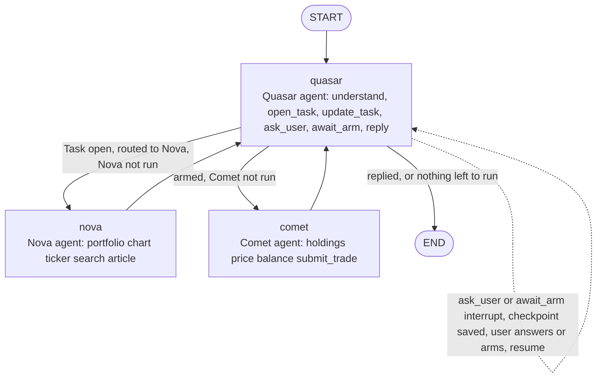

# Agent Workflow as a Graph of ADK Agents

> English per PulsarFi AGENTS.md §7. New code follows `~/coding-style-skill` (go-style, function-design, naming, errors, comments, code-review); PulsarFi's AGENTS.md has no rule that conflicts with it.

| | |
|---|---|
| **Version** | 1.19 |
| **Status** | Approved |
| **Date Created** | 2026-11-10 |
| **Last Updated** | 2026-11-11 |

| Version | Date | Change |
|---|---|---|
| 1.19 | 2026-11-11 | Latency Measurement: added the per-query breakdown of a full live run (Task 483) and the comparison with pre-graph Tasks. No code change. |
| 1.18 | 2026-11-11 | `interruptFrom` (`stream_service.go`): removed the two pointer `case`s (`*QuestionsInterrupt`, `*ArmInterrupt`) inherited from `main`. Measured offline: the interrupt `Info` is a value at both call sites (agent event and graph error) and after a gob round-trip. |
| 1.17 | 2026-11-11 | `supervisor/understand_tool.go` merged into `supervisor/tools_service.go`, next to the other Quasar tools. No behaviour change. |
| 1.16 | 2026-11-11 | `turn_scope.go` merged into `orchestrator_service.go` (per-request scope and the `runAgentStep` adapter); no helper file remains in `orchestrator/` beyond the services. Changed: Impacted Files note on the node adapter. |
| 1.15 | 2026-11-11 | At the owner's direction: `workflow_service.go` renamed to `task_lifecycle_service.go`; each node now lives in its agent's `index.go` (`supervisor.NewNode`, `analyzer.NewNode`, `executor.NewNode`) and is wired by `buildGraph` in `orchestrator_service.go`, so `quasar_node.go`, `nova_node.go` and `comet_node.go` no longer exist. The node functions receive the runner step as an injected `agentcore.StepFunc`, and `ErrToolBudgetExhausted` moved to core. Code Shape samples below keep the original names (`runQuasar`, `runNova`, `runComet`). |
| 1.14 | 2026-11-11 | Service layer cleaned at the owner's direction: the timing instrumentation was removed from `service/` (`timed_chat_model.go`, `chain_timing.go`, the `slog` lines in `recorder_service.go`, `workflow_service.go`, `onchain_service.go`, the registry wrapper), and the graph moved into `orchestrator_service.go` (`orchestrator_service.go` deleted). Every mention of `orchestrator_service.go` below now means `orchestrator_service.go`. The instrumentation outside `service/` (`config/query_stats.go`, `middleware/logger.go`, `router.go`) is still in place. |
| 1.13 | 2026-11-11 | Moved the shared runner step out of the service layer into `app/core/agent/agent_step.go` (`AgentStep.Execute`, `AgentPause`, `AgentCheckpointID`), at the owner's direction. The event reader is injected, so core depends on no service. The checkpoint is deleted only when a node was resumed (a clean run writes none). Changed: Implementation Status. |
| 1.12 | 2026-11-11 | Measurement only, no behaviour change: per-request query stats and pool counters in the request log, and send/wait timing for every on-chain transaction. Findings from reading the code are listed under Latency Measurement. |
| 1.11 | 2026-11-10 | Latency measurement after a 55.8s trade-intake turn (Task 477): added timing logs only, no behaviour change. Added "Latency Measurement" after Implementation Status. |
| 1.10 | 2026-11-10 | Implemented on branch `refactor`. Added "Implementation Status" after Stage 0 Results with the deviations from this plan: no `reply` tool, the route lives in `RunContext`/`TurnState` and not in `RouteDecision`, a refused `await_arm` ends the Quasar run, side-turn behaviour. |
| 1.9 | 2026-11-10 | Removed the references to an external reference project from the changelog row 1.0, the Problem Statement comparison table (one column and its cells) and the "Events" paragraph of the Feature Description; the repo is public. |
| 1.8 | 2026-11-10 | Stage 0 spike written and run: `backend/test/service/agent/graph_spike_test.go`. Added "Stage 0 Results" after the Verification Plan. Resolved the `RouteDecision` path UNVERIFIED: the current struct has no path field, so `understand` adds one. |
| 1.7 | 2026-11-10 | Status Draft to Approved by the owner. Copied into `docs/plans/` on branch `refactor`; removed the "Draft for" note from the intro. |
| 1.6 | 2026-11-10 | Showed where each ADK agent is called in the graph (all three node bodies) and the evidence from #29 for running an agent inside a node, plus what is still unproven. Changed: Feature Description (new "Proof" block), Code Shape (node bodies), Verification Plan item 1. |
| 1.5 | 2026-11-10 | Owner choice: one Quasar node in a loop (supervisor pattern), three nodes `quasar`, `nova`, `comet`. Replaced `quasar_intake` and `quasar_finish`. Changed: Definition of Done, Feature Description, Impacted Files, Code Shape, Flowchart, Verification Plan, Open Decisions. |
| 1.4 | 2026-11-10 | Nodes are the agents; `understand` and `reply` are Quasar's tools. |
| 1.3 | 2026-11-10 | Showed where the ADK agents are built and held. |
| 1.2 | 2026-11-10 | Applied the owner's coding-style skill. |
| 1.1 | 2026-11-10 | `open_task` and `await_arm` stay Quasar tools; no `commit` node. |
| 1.0 | 2026-11-10 | Initial draft, rebuilt after reading `8442621` (#29), `0626dd9` (#30), `3e86f79^`, and current `main`. |

## Problem Statement

Today the order of work (Task on chain, Nova, card, arm pause, Comet) is not visible in code. It lives in Quasar's prompt and in refusals inside its tools (`supervisor/tools_service.go:154-165, 228-238, 300-310`). Hand-built graphs existed before and were dropped, so the shapes were compared first.

| | #29 (`8442621`) | #30 to `3e86f79^` | Now (#48+) |
|---|---|---|---|
| Frame | Eino graph, 4 nodes | Eino graph, 5 nodes `understand commit analyze reply execute` | None |
| Quasar | Raw model calls | Same | One `ChatModelAgent`, 6 tools |
| Nova, Comet | `adk.Agent` run in a node (`runRoleAgent`, `orchestrator_parsers.go:154-232`) | Same | Tools of Quasar |
| User pause | Fake `pending_trade` row; Comet called outside the graph | Eino interrupts | Eino interrupts from tools (`ask_user`, `await_arm`) |
| Events to client | Callbacks in the turn struct | Same; gob dropped the func fields on checkpoint | One Runner stream, one `consume` loop |

What made the old graphs hard (from their own plan docs and code):
- State held 7 callbacks plus `runCtx`; gob drops funcs on checkpoint, so `turnCallbacks`, `onLatestSnapshot`, `ensureRunContext` existed as workarounds.
- At #29 the `execute` node had no inbound edge, so Comet never ran in the graph; `ExecuteTask` became a second execution path (plan #30, Findings #6, #7).
- `runUnderstand` was 131 lines mixing prompt, chain write, DB write and interrupt.
- The shape of the graph was not the problem.

Goal: a visible graph whose edges decide when Nova and Comet run, with Quasar, Nova and Comet as ADK agents whose abilities are tools, and without the old callback plumbing.

## Definition of Done

1. The workflow is a graph in one file (`orchestrator/orchestrator_service.go`).
2. Three nodes, one per agent: `quasar`, `nova`, `comet`, each an `adk.ChatModelAgent` run by its own runner. `nova` and `comet` return to `quasar`; the graph is bounded by `compose.WithMaxRunSteps`.
3. Quasar's abilities are tools: `understand`, `open_task`, `update_task`, `ask_user`, `await_arm`, `reply`.
4. Edges decide Nova and Comet: Nova runs only when `understand` routed to Nova, a Task is open and Nova has not run; Comet runs only after `await_arm` returned "armed".
5. Checkpoint works: a pause at `ask_user` or `await_arm` is saved in the Postgres checkpoint store and the graph restarts from that node on resume, also after a process restart.
6. Graph state is plain data (no funcs, no recorder, no callbacks) so gob can save it.
7. Tokens, thinking, tool calls and sub-task events reach the client over the existing websocket as now.
8. No HTTP route, response JSON, websocket topic or event type, DB schema or on-chain call changes. The `content_type` and `ui_props` of every reply stay byte-identical.
9. Every new function passes the "and" test, has one entry point per folder scope, and carries no comments except parameter docblocks.

## Feature Description

**Graph (supervisor loop).** `quasar` runs first. A branch after it reads the state and picks the next node. `nova` and `comet` hand control back to `quasar`. The loop ends when Quasar has replied.

**Quasar's tools**
- `understand` (new): decides where the request goes: ask Nova, execute a trade, or neither. It takes the routing part of today's `RouteDecision` (path `analyzer_only`, `analyzer_then_executor`, `executor_only`, `none`). The branch reads this result.
- `open_task`, `update_task`, `ask_user`, `await_arm`: unchanged.
- `reply` (new): Quasar ends its turn by calling it with the text and the `content_type` (`text`, `chart`, `news`, `workflow_card`). Today the type is guessed after the turn by `ClassifyReply` (`reply_classifier.go:141`), which re-reads Nova's tool JSON. With `reply` the type comes from Quasar; code still builds `ui_props` from Nova's tool results kept in state, so shapes do not change. `reply` is a `ReturnDirectly` tool (`adk.ToolsConfig.ReturnDirectly`, `adk/chatmodel.go:141`, read from Eino v0.9.15). UNVERIFIED: the exact `reply` arguments; the existing `ClassifyReply` tests define the output that must not change.

**What Quasar sees on re-entry.** The `nova` node appends Nova's findings and verdict to `state.Messages` before returning; the `comet` node appends Comet's result. Quasar's next run starts from those messages, so it knows what already happened.

**Where each existing piece goes**
- `analyzer_agent` tool → node `nova` (body of `analyzerCall.InvokableRun`, `tools_service.go:228-277`).
- `executor_agent` tool → node `comet` (body of `executorCall.InvokableRun`, `:300-340`). Its armed check (`ArmedTaskReader`, `:305-310`) becomes the branch rule before `comet`.
- `await_arm` runs inside node `quasar`, interrupts, and returns "armed" on resume.
- `consume`, `finishInterrupt`, `finalizeResult` (`stream_service.go`) stay; nodes use them.

**Agents (all three are `adk.ChatModelAgent`, built the way they are today)**
- Quasar: `supervisor.New` (`supervisor/index.go:40-85`), `Name: "supervisor_agent"`. Today it also receives `analyzerAgent` and `executorAgent` and wraps them as the tools `analyzer_agent` and `executor_agent` (`:53-64`); that wrapping and the `ArmedTaskReader` parameter are removed.
- Nova: `analyzer.New` (`analyzer/index.go:15-51`), `Name: "analyzer_agent"`. Unchanged.
- Comet: `executor.New` (`executor/index.go`), `Name: "executor_agent"`. Unchanged.
- `Orchestrator` (`orchestrator_service.go:43-57`) holds `Quasar` today; it gets `Nova` and `Comet` the same way, plus one `adk.Runner` per agent built in `NewOrchestrator` (today one runner, `:74-84`). `agent_registry.go:117-155` builds the three agents and passes them in.

**Proof that an ADK agent runs inside a graph node.**
- Proven by code, not run again by this plan: at #29 the node `runAnalyze` (`8442621:orchestrator_nodes.go:258-304`) calls `runRoleAgent(WithRunContext(ctx, turn.runCtx), o.Analyzer, request, ...)`, and `runRoleAgent` (`orchestrator_parsers.go:154-232`) does `iterator := a.Run(ctx, &adk.AgentInput{Messages: ..., EnableStreaming: true}, runOpts...)` then loops `iterator.Next()` over the events, draining streamed assistant tokens and collecting tool results. The same pattern is in `runExecute` and, at #30, in `runAnalyze` and `runExecute` of `orchestrator_workflow_service.go`. The #30 plan (`agent-orchestration-graph-rebuild.md` v2.6, v2.17) records live use against the real model, including a bug found in a real executor-only prompt.
- Not proven, and why each is a spike test (see Verification Plan): Quasar as an agent in a node (at #29 and #30 Quasar was a plain model call); a tool interrupt inside an agent inside a node (`a.Run` at #29 has no checkpoint; an `adk.Runner` is what carries one); a cycle (#29 and #30 were linear).
- What changes from #29: the `OnToolCall` and `OnThinking` callbacks that `runRoleAgent` receives are the plumbing that made the old graph hard. Here the node publishes the events itself.

**Events.** A node reads its agent's event iterator and publishes straight to `realtime.Publish("agent-chat-stream:<chatID>")` (what `publishMessage` does now). Chat id and wallet come from the state. No callbacks in state. Tools write what they decide (`TaskID`, `Decision`, `Armed`, `Replied`) into the `RunContext` carried in `ctx`, as `open_task` does today; the node copies those plain fields into the state after the agent run.

**Resume.** Checkpoint ID is the chat id (as `WithCheckPointID(chatID)` now). The recorder is rebuilt from the Task row on resume (as `restoreRunContext` does now), not kept in state.

**Known limit of the loop.** Edges control when Nova and Comet run. They cannot control the order of Quasar's own tools inside one run, so `await_arm` keeps one small refusal: it refuses while the route needs Nova and Nova has not run. Every other order guard goes away.

**Goes away:** the tools `analyzer_agent` and `executor_agent` and the order guards in them (except the one above); `Orchestrator.dispatchTurn`'s second switch and the marker re-read in `ResumeExecute`; the guessing part of `ClassifyReply`.

**Style scope.** New lines follow the skill. Moved bodies are rewritten in that style (full-word receiver `orchestrator`, no narration comments). Surrounding legacy code is left alone; no style migration.

**Out of scope (separate plans):** handler → service layering, env cleanup, dead code, and bugs found (`Side` parsing in `submit_trade`, `/execute` overlapping a chat turn, unlocked `SetCurrent`, Indonesian text in `cleanExecutionReply`).

## Impacted Files

| File | Change |
|---|---|
| `[NEW]` `orchestrator/orchestrator_service.go` | The one entry point that composes the stages: topology and branch only |
| `supervisor/index.go` | `NewNode`: the node `quasar` |
| `analyzer/index.go` | `NewNode`: the node `nova` |
| `executor/index.go` | `NewNode`: the node `comet` |
| `[NEW]` `app/core/agent/turn_state.go` | Plain-data state, sibling of `run_context.go` |
| `orchestrator/orchestrator_service.go` | Holds three agents and three runners; `Send`, `ResumeExecute` invoke the graph; second intent switch deleted |
| `orchestrator/stream_service.go` | Event loop shared by the nodes; Quasar-only finishing stays in `quasar_node.go` |
| `supervisor/index.go` | `New` loses `analyzerAgent`, `executorAgent`, `armed`; builds Quasar with 6 tools, `reply` as `ReturnDirectly` |
| `supervisor/tools_service.go` | Add `understand` and `reply`; delete `analyzerCall`, `executorCall`, `rewrapRequest`, `innerAgentTool` and the guards except the `await_arm` one |
| `supervisor/instructions.go` | Prompt loses the ordering rules; describes the six tools and the re-entry messages |
| `app/helper/reply_classifier.go` | `ClassifyReply` takes the type from `reply` instead of guessing; `ui_props` assembly unchanged |
| `service/agent_registry.go` | Build Nova, Comet, Quasar side by side and hand all three to `Orchestrator` (`:117-155`) |
| `service/agent/README.md` | Graph diagram and the reasons for this shape |

**Reuse check for `[NEW]`.**
- Graph and node files: read #29 `orchestrator_service.go:77-133`, #30 `orchestrator_service.go:89-175` and today's `orchestrator/` and `supervisor/`. Node bodies already exist as tool bodies, so this moves them. The old graph cannot be restored as-is because it carried callbacks in state and was linear.
- One file per node (folder = one scope, file = one flow stage); nodes stay methods on `Orchestrator`, not a new package.
- `turn_state.go`: `RunContext` holds `Recorder` and `Stream`, which gob cannot save, so it cannot be the graph state. The new type holds only data fields; `RunContext` stays in `ctx` for the recorder.
- No table, migration, interface, helper or `utils` package.

## Code Shape

Four-space indent, no comments, full words.

`orchestrator_service.go`
```go
func (orchestrator *Orchestrator) buildGraph(ctx context.Context) (compose.Runnable[*agentcore.TurnState, *agentcore.TurnState], error) {
    graph := compose.NewGraph[*agentcore.TurnState, *agentcore.TurnState]()
    graph.AddLambdaNode("quasar", compose.InvokableLambda(orchestrator.runQuasar))
    graph.AddLambdaNode("nova", compose.InvokableLambda(orchestrator.runNova))
    graph.AddLambdaNode("comet", compose.InvokableLambda(orchestrator.runComet))

    graph.AddEdge(compose.START, "quasar")
    graph.AddBranch("quasar", compose.NewGraphBranch(func(_ context.Context, state *agentcore.TurnState) (string, error) {
        if state.Replied {
            return compose.END, nil
        }

        if state.TaskID != 0 && state.Decision.NeedsNova() && !state.NovaDone {
            return "nova", nil
        }

        if state.Armed && !state.CometDone {
            return "comet", nil
        }

        return compose.END, nil
    }, map[string]bool{"nova": true, "comet": true, compose.END: true}))
    graph.AddEdge("nova", "quasar")
    graph.AddEdge("comet", "quasar")

    return graph.Compile(ctx,
        compose.WithCheckPointStore(orchestrator.CheckPointStore),
        compose.WithMaxRunSteps(maxGraphSteps),
    )
}
```
The branch is one inline closure; a helper waits for a third use. Eino's default trigger mode is pregel, which allows cycles (`graph_compile_options.go:22`, `graph.go:46`). UNVERIFIED: how `WithMaxRunSteps` counts steps and what `maxGraphSteps` must be for a full turn (quasar, nova, quasar, comet, quasar is 5 entries plus resumes); the spike measures it. UNVERIFIED: the field of the current `RouteDecision` that holds the path; the old graph used `Decision.Path` with `pathAnalyzerOnly`, `pathAnalyzerThenExecutor`. `NeedsNova` is a method on `RouteDecision`.

`turn_state.go`
```go
type TurnState struct {
    ChatID   uuid.UUID
    Wallet   string
    Messages []*schema.Message

    TaskID      int64
    Decision    RouteDecision
    Verdict     *NovaVerdict
    NovaDone    bool
    Armed       bool
    CometDone   bool
    Replied     bool
    Reply       string
    ContentType string
}
```

Agent construction (the three agents stay `adk.ChatModelAgent`)

`supervisor/index.go`
```go
func New(ctx context.Context, chatModel model.ToolCallingChatModel, tasks TaskOpener) (adk.Agent, error)
```
Builds `understand`, `open_task`, `update_task`, `ask_user`, `await_arm`, `reply`, then:
```go
adk.NewChatModelAgent(ctx, &adk.ChatModelAgentConfig{
    Name:          "supervisor_agent",
    Instruction:   instructions,
    Model:         chatModel,
    GenModelInput: withCurrentTime,
    ToolsConfig: adk.ToolsConfig{
        ToolsNodeConfig:    compose.ToolsNodeConfig{Tools: []tool.BaseTool{understand, openTask, updateTask, askUser, awaitArm, reply}},
        ReturnDirectly:     map[string]bool{"reply": true},
        EmitInternalEvents: true,
    },
    MaxIterations: 12,
})
```
`analyzer.New` and `executor.New` are unchanged.

`orchestrator_service.go`
```go
type Orchestrator struct {
    Tasks        *repository.AgentTaskRepository
    SubTasks     *repository.AgentSubTaskRepository
    ChatMessages *repository.AgentChatMessageRepository
    Chain        OrchestratorChainClient

    Quasar     adk.Agent
    Nova       adk.Agent
    Comet      adk.Agent
    ReplyModel model.BaseChatModel

    Stocks          StockCatalog
    CheckPointStore agentcore.ExtendedCheckPointStore

    graph        compose.Runnable[*agentcore.TurnState, *agentcore.TurnState]
    quasarRunner *adk.Runner
    novaRunner   *adk.Runner
    cometRunner  *adk.Runner
}
```

Where each agent is called. Each node loads the run context, runs its own runner, and reads the events:
```go
func (orchestrator *Orchestrator) runQuasar(ctx context.Context, state *agentcore.TurnState) (*agentcore.TurnState, error) {
    run, err := orchestrator.loadRunContext(ctx, state)
    if err != nil {
        return nil, err
    }

    events := orchestrator.quasarRunner.Run(agentcore.WithRunContext(ctx, run), state.Messages, adk.WithCheckPointID(state.ChatID.String()+":quasar"))

    return orchestrator.collectQuasarTurn(ctx, run, state, events)
}

func (orchestrator *Orchestrator) runNova(ctx context.Context, state *agentcore.TurnState) (*agentcore.TurnState, error) {
    run, err := orchestrator.loadRunContext(ctx, state)
    if err != nil {
        return nil, err
    }

    request := helper.BuildAnalyzerRequest(state.Messages, state.Decision)
    events := orchestrator.novaRunner.Run(agentcore.WithRunContext(ctx, run), []adk.Message{schema.UserMessage(request)}, adk.WithCheckPointID(state.ChatID.String()+":nova"))

    return orchestrator.collectNovaVerdict(ctx, run, state, events)
}

func (orchestrator *Orchestrator) runComet(ctx context.Context, state *agentcore.TurnState) (*agentcore.TurnState, error) {
    run, err := orchestrator.loadRunContext(ctx, state)
    if err != nil {
        return nil, err
    }

    request := helper.BuildExecutorRequest(state.Messages, state.Verdict)
    events := orchestrator.cometRunner.Run(agentcore.WithRunContext(ctx, run), []adk.Message{schema.UserMessage(request)}, adk.WithCheckPointID(state.ChatID.String()+":comet"))

    return orchestrator.collectCometResult(ctx, run, state, events)
}
```
`quasarRunner`, `novaRunner`, `cometRunner` are the `adk.Runner`s over `Orchestrator.Quasar`, `.Nova`, `.Comet`. `BuildAnalyzerRequest` exists (`app/helper/nova_verdict.go:37`); `BuildExecutorRequest` is today's `executeInstruction` suffix added in `executorCall` (`tools_service.go:279,312-314`) moved into `app/helper`. The three `collect*` steps share one event loop (the loop of `consume`, third use) and differ only in what they take from the events.
`loadRunContext` is the rebuild-from-Task-row step (today `restoreRunContext`). `collectNovaVerdict` reads Nova's events through the existing event loop of `consume`, publishes them, records `gather_evidence`, sets `Verdict` and `NovaDone`, and appends Nova's findings to `state.Messages`. UNVERIFIED: `consume` (`stream_service.go:194`) mixes the event loop with Quasar-only finishing (`finishInterrupt`, `finalizeResult`); the plan splits it so the loop is shared and the finishing stays with `runQuasar`, checked by the existing flow tests.

Node methods, one per file, each private, each split into private steps behind that one method (load context, run agent, collect result, record sub-task):
```go
func (orchestrator *Orchestrator) runQuasar(ctx context.Context, state *agentcore.TurnState) (*agentcore.TurnState, error)
func (orchestrator *Orchestrator) runNova(ctx context.Context, state *agentcore.TurnState) (*agentcore.TurnState, error)
func (orchestrator *Orchestrator) runComet(ctx context.Context, state *agentcore.TurnState) (*agentcore.TurnState, error)
```
- `runQuasar`: runs Quasar over `state.Messages`; copies `TaskID`, `Decision`, `Armed`, `Replied`, `Reply`, `ContentType` from the `RunContext` into the state.
- `runNova`: records `route_to_analyzer`, runs Nova, parses the verdict, records `gather_evidence`.
- `runComet`: records `route_to_executor`, runs Comet, records `decide` when Comet's tools recorded nothing; sets `CometDone`.

**Call flow:** handler → `ChatService` turn slot → `Orchestrator.Send` → graph → nodes publish to websocket → persisted reply. Execute: handler → `TaskService.ExecuteTask` → `Orchestrator.ResumeExecute` → graph resumes in `quasar`, `await_arm` returns "armed", the branch opens `comet`, then `quasar` writes the result reply.

**Errors:** nodes return the error, wrapped once with scope (`"orchestrator: ..."`), no logging on the main path; a non-critical side effect (a failed sub-task record that must not stop the turn) logs with `slog.ErrorContext(ctx, "orchestrator: ...", "chat_id", ..., "error", err)`.

**Deleted:** tools `analyzer_agent`, `executor_agent` and their guards; `chatIDForTask` duplicates; unused `RunContext` fields.

## UI/UX Changes (Lo-Fi)

None. Same events: `turn`, `reply_delta`, `thinking`, `tool_call`, `sub_tasks`, `final`, `error`. Sub-task order unchanged.

## Flowchart



## Verification Plan

Stage 0 spike, tests only, in `backend/test/service/agent/`, stdlib `testing`, hand-written fakes, names state the guarantee (for example `TestOrchestratorGraph_ResumesAwaitArmAfterRestart`). Nothing else starts until all pass; if one fails, stop and bring it to the owner.
1. Each of the three agents runs inside its node and its tokens, thinking and tool calls reach the websocket publisher with no callback in state. Nova and Comet by `Agent.Run` inside a node are shown by #29/#30 code (see "Proof"); the spike repeats it with `adk.Runner` on current Eino v0.9.15 and adds Quasar. The Runner alone is proven by `eino_agent_tool_proof_test.go`. Tool options must be forwarded (spike S5 in `tools_service.go:211-213`).
2. A tool interrupt (`ask_user`, `await_arm`) inside an agent run by an `adk.Runner` inside a graph node is saved in the Postgres store and resumes, including after building a new `Orchestrator`. Two checkpoints exist: the graph's and the node's runner (checkpoint id `<chatID>:<node>`). The spike must show how a node surfaces its runner's interrupt to the graph (for example by raising `compose.StatefulInterrupt` carrying the runner's interrupt id) and how resume re-enters the node and calls `ResumeWithParams`. UNVERIFIED, and the largest risk of this plan. The code records that an agent tool called inside a tool that interrupted fails (spike S3, `tools_service.go:135-137`); #30 noted Eino passes nil input on resume to a manually interrupted node, UNVERIFIED for v0.9.15.
3. The loop works: `quasar → nova → quasar → comet → quasar → END` runs, `WithMaxRunSteps` stops a runaway loop, and a node re-entered after an interrupt does not count as a runaway.
4. `TurnState` round-trips through gob with `schema.RegisterName` (#30 hit a panic from registering the wrong type).
5. A tool's result (`Armed`, `Decision`, `Replied`) written into `RunContext` is visible to the node after the agent run; `reply` as a `ReturnDirectly` tool ends Quasar's run.

After the spike: record the event, sub-task sequence, `content_type` and `ui_props` on current code for small talk, news/chart card, questions then answer, trade card → arm → execute, cancel, tool-budget exhaustion; the graph must reproduce them. Keep green: `agent_as_tool_flow_test.go`, `eino_agent_tool_proof_test.go`, `chat_retry_scope_test.go`, `tool_budget_test.go`, `TestTurnRegistry`, `TestChatTurn_SurvivesACancelledRequest`. Run `go build ./...`, `go vet ./...`, `go test -race ./test/...` (non-live). `gofmt` is not run: the style skill indents with four spaces and `gofmt` rewrites to tabs. Live tests (`*_live_test.go`) and the end-to-end run on the local stack (chat → Arm Card → arm → execute) are run by the owner: the change must be exercised, not only compiled.

## Stage 0 Results

Run on branch `refactor` with scripted fake models, Eino v0.9.15, `go test -race`. No network and no database. File: `backend/test/service/agent/graph_spike_test.go`.

| Spike item | Test | Result |
|---|---|---|
| 1. An agent runs inside a graph node and its streamed events reach the node | `TestGraphSpike_AgentRunsInsideNodeAndStreamsEvents` | Pass: streamed event with several chunks and readable reasoning |
| 2. A tool interrupt (`ask_user`, `await_arm`) inside an agent inside a node is saved and resumes after a restart | `TestGraphSpike_ToolInterruptInsideNodeSurvivesRestart` | Pass for both tools, with a new graph, new agent and the same store |
| 3. The loop runs and a runaway stops | `TestGraphSpike_LoopRunsQuasarNovaQuasarCometQuasarAndEnds`, `TestGraphSpike_MaxRunStepsStopsARunawayLoop` | Pass: the full turn needs `WithMaxRunSteps` of at least 5 (one step per node entry); a runaway stops with `ErrExceedMaxSteps` |
| 4. State survives gob | `TestGraphSpike_TurnStateRoundTripsThroughGob` | Pass with a test-local mirror of the planned fields, using the real `RouteDecision` and `NovaVerdict` |
| 5. A tool's write into `RunContext` reaches the node; `reply` as `ReturnDirectly` ends the run | `TestGraphSpike_ToolResultReachesNodeAndReplyEndsTheRun` | Pass; with `ReturnDirectly` removed the test fails (the model is asked again), so the test is not vacuous |

How item 2 works, as proven: the node runs the agent with its own runner (checkpoint id `<chatID>:quasar`). When the runner's events carry an interrupt, the node returns `compose.StatefulInterrupt` carrying the runner's interrupt id and the plain state. On resume the graph calls the node with a nil input; the node reads `compose.GetInterruptState` and `compose.GetResumeContext`, takes the state from the saved interrupt and calls `Runner.ResumeWithParams` with the inner interrupt id. This resolves the "nil input on resume" question for v0.9.15.

Not covered by the spike:
- A node re-entered after an interrupt: whether it counts as a new step against `WithMaxRunSteps`. The Verification Plan item 3 claim stays open; Stage 2 sets `maxGraphSteps` with headroom and a test.
- The real Quasar prompt and real DeepSeek. The scripted models prove the mechanism, not model behaviour; the live tests are run by the owner.
- Publishing to the websocket: the spike checks the events reach the node, not `realtime.Publish`.
- The characterization tests (`TestFlow*`) skip without a database, so the baseline event and sub-task sequences are not recorded yet. They need a test database; the existing live tests connect to the configured Supabase and failed with `EMAXCONNSESSION` on connect when the whole package was run.

Finding that changes the plan: `RouteDecision` (`app/core/agent/decision.go:8-18`) has no routing path field (`IsActionable`, `Summary`, `Label`, `Shape`, `Side`, `MentionedTicker`, `BudgetIDRX`, `SellAmount`, `Card`). The old graph's `Decision.Path` no longer exists. The new `understand` tool adds a path field to `RouteDecision`, and `NeedsNova` reads it.

## Implementation Status

Built on branch `refactor`. `go build ./...` and `go vet ./...` pass. Offline tests pass with `-race`: `TestOrchestratorGraph_*` (3), `TestGraphSpike_*` (6), `TestEinoProof*`, `TestToolBudget_TruncatesInsteadOfFailing`, `TestTurnRegistry_*`. The database-backed flow tests (`TestFlow*`, `TestChat*`) were updated for the new flow and compile, but were NOT run: they need a database, so the resume paths (`AnswerQuestions`, `ResumeExecute`, the side turn) and the Comet node are not exercised by any passing test yet.

What exists:
- Graph and nodes: `orchestrator/orchestrator_service.go`, `quasar_node.go`, `nova_node.go`, `comet_node.go`, per-request scope and the thin adapter `runAgentStep` in the same file. The shared runner step itself lives in core: `app/core/agent/agent_step.go`.
- State: `app/core/agent/turn_state.go`; `RunContext` gained `Route`, `NovaRequest`, `NovaDone`, `Armed`.
- Quasar: `supervisor.New(ctx, model, tasks)` builds five tools (`understand`, `open_task`, `ask_user`, `update_task`, `await_arm`); `await_arm` is `ReturnDirectly`. `analyzer_agent` and `executor_agent` tools and their guards are deleted. Instructions rewritten for the new flow.
- `Orchestrator` holds `Quasar`, `Nova`, `Comet` and one runner each; `Send` and `ResumeExecute` invoke the graph; `consume` became the shared `readEvents`.
- `app/helper/executor_request.go`: `BuildExecutorRequest` (Comet's request, built from the Task, the confirmed parameters and Nova's findings).

Deviations from this plan, each a decision to confirm:
1. **No `reply` tool.** A `ReturnDirectly` `reply` tool would end Quasar's run in the same model message that carries the tool call, so the answer text would have to travel as tool-call arguments and could no longer stream token by token over `reply_delta`; the control flow does not need it (the graph ends when Quasar has nothing left to hand off), and `ClassifyReply` already derives the content type from Nova's own tool results, so replacing it would risk changing `content_type` and `ui_props`. Quasar's final answer stays plain streamed text.
2. **The route is not a field of `RouteDecision`.** Adding it would put `route` into the argument schema of `open_task` and `update_task` and lose it on resume, because `decisionFromTask` rebuilds the decision from the stored trigger JSON. The `understand` tool writes `RunContext.Route` and `NovaRequest`; the node copies them into `TurnState`, which the graph checkpoint saves.
3. **A refused `await_arm` ends Quasar's run.** `await_arm` is `ReturnDirectly`, so a refusal (no Task yet, not actionable, or Nova still due) also returns directly. When Nova is due the graph then runs Nova, which is the wanted outcome; in the other cases the turn ends without a reply.
4. **Side question during the Arm pause.** The side turn runs the graph without a graph checkpoint and with its own agent checkpoint ids, so the pending Arm pause is untouched. A pause raised by the side turn itself is dropped (the marker is not overwritten), where before it replaced the Arm pause.
5. **Quasar's memory across runs.** Each Quasar entry is a fresh run over `state.Messages`; what Nova or Comet did reaches it as a user-role message that starts with "System note:", which the instructions explain.
6. **Nova's and Comet's requests.** Nova gets the user's request from `understand`'s `request_for_nova` plus the Task's parameters (`BuildAnalyzerRequest`, as before); Comet's request is built in code from the Task, not written by Quasar. The `comet` node re-checks that the Task is armed before running Comet.

Not verified: behaviour with the real model and real prompts; the database-backed flows; that the instructions make Quasar end its turn after `update_task` when Nova is due; `maxGraphSteps = 20` against interrupt re-entries.

## Latency Measurement

Observed on the local run, chat `53db8234`, message "Bisa lakukan trade? Ke BBRIP sih": the POST took 55.85s. Sub-task and message timestamps in the database split the 53.8s from message to saved reply into 24.0s before the Task row exists (LLM only), 5.7s `createTask` plus `understand_request`, 8.8s `route_decision`, and 15.3s for the `ask_user` reply: about 39s LLM and 14.5s on-chain, all sequential. The running build was the graph build (the checkpoint table holds `<chat>:quasar`). The per-call split inside the 24s and the 15s was not measurable from the database.

Findings from reading the code (not yet measured; the logs below are meant to confirm or reject them):
- `config.NewDatabase` sets `MaxOpenConns(5)` and `MaxIdleConns(1)`. The frontend polls several endpoints at once, so a chat turn can queue behind them for a connection, and every burst closes the idle connections the next burst must reopen over TLS to Tokyo.
- `OnchainService` takes one mutex (`s.mu`) for `CreateTask`, `MarkActionable`, `GrantTradePermission`, `RecordSubTasks` and `ExecuteTrade`, so every transaction from every request queues behind the previous one, and the mutex is held while waiting for the receipt.
- `bind.WaitMined` polls the receipt once per second (`go-ethereum v1.17.3`, `accounts/abi/bind/v2/util.go:33`), so each transaction waits in whole seconds even if the block is mined sooner.
- An LLM call costs about 2s plus characters divided by 360 per second: 26 calls over three runs total 181.2s measured against 175.3s predicted by that formula, so the app adds no hidden overhead around the model.

Added in v1.12, `INFO` lines in `logs/app.log`:
- The existing `request` line gains `db_queries`, `db_ms`, `db_top` (kind, table, count and time of the four slowest query kinds; the SQL text is never logged), `pool_wait_count`, `pool_wait_ms`, `pool_idle_closed`, `pool_open`. The pool counters are deltas of the shared pool, so concurrent requests are included. Files: `config/query_stats.go`, `config/database.go`, `http/middleware/logger.go`, `http/routes/router.go`.
- `agent: chain tx` per transaction: `tx`, `lock_wait_ms`, `prepare_and_send_ms`, `wait_mined_ms`, `total_ms` (`service/external/chain_timing.go`, used by the five methods of `onchain_service.go`).

Added in v1.11, one line each, all `INFO` in `logs/app.log`:
- `agent: llm call` per model call: `agent` (quasar, nova, comet), `mode`, `chat_id`, `input_messages`, `first_chunk_ms`, `total_ms`, `output_chars`, `tool_calls` (`service/external/timed_chat_model.go`, wrapped in `agent_registry.go`).
- `agent: node finished` per graph node: `node`, `paused`, `duration_ms`.
- `agent: chain call` for `createTask` and `markActionable`, and `agent: sub task recorded` with `chain_ms` and `database_ms` per step.
- `agent: task committed` with the total of `CommitTask`.

The next step is to repeat the same turns and read these lines, then decide what to change from the numbers.

### Run of 2026-11-11 (Task 483, plain flash, query stats active)

Full scenario 137.1s: greeting 5.6s, trade intent 28.4s, answers 22.1s and 28.9s, arm 8.1s, approve 2.3s, execute 39.8s.

- Database: 91 queries took 38.0s of the 132.8s spent in the six requests (`db_ms` 2.9, 5.1, 5.7, 8.3, 3.5, 12.6s). `pool_wait_count` was 0 in every request, so the pool is not the cause. A SELECT costs about 170ms (one round trip to Tokyo, measured 100 to 170ms with `psql`), a write costs 400 to 1,500ms. UNVERIFIED cause of the write cost: GORM wraps each write in its own transaction (`SkipDefaultTransaction` is not set in `config/database.go`), which is three round trips.
- Checkpoints: every pause writes three `agent_checkpoints` rows (agent runner, graph, interrupt marker), 1.5 to 3.2s per pause; the runner checkpoint is about 380KB.
- Fill time: the trade transaction is sent about 21s after the execute request starts (`route_to_executor` at +5s, `decide` at +19.5s, after two Comet model calls), about 31s after the Arm click. The remaining 18s of the execute request is sub-task records and two model calls for the summary.
- Graph cost against `main`: message to first sub-task was 17 to 20s on Tasks 461 to 465 (2026-10-26, `main`) and 20 to 38s on Tasks 476 to 483 (graph). The added `understand` call took 7.8s in the logged run of 2026-11-10. The model used on 2026-10-26 is not recorded.

## Open Decisions (owner)

0. If spike 2 shows a runner inside a node cannot hand its interrupt to the graph without a callback-style workaround like the one removed in #48, stop and bring the failing test to the owner. No silent fallback.
1. With `open_task` a Quasar tool, an edge can only check that a Task exists, not force Quasar to open one. If Quasar skips `open_task` on a trade request, the branch ends the turn with Quasar's reply. Is that acceptable?
2. The errors skill wants one `AppError`; PulsarFi has none. Recommendation: this plan keeps the errors the code already returns; an `AppError` is its own plan.
3. Should the behaviour bugs under "Out of scope" become separate plans? (`Side` parsing and `/execute` overlap can lose money.)
