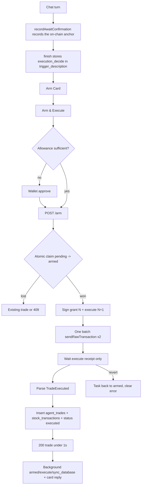

# Instant Execution — Click to On-Chain to DB Under One Second

| | |
|---|---|
| **Version** | 3.2 |
| **Status** | In Progress |
| **Date Created** | 2026-10-25 |
| **Last Updated** | 2026-10-25 |

| Version | Date | Change |
|---|---|---|
| 3.2 | 2026-10-25 | Final local measurement after the 30s fee cache and the stored `stock_id`: 2.85s / 1.48s / 1.68s. The warm runs are 1.48–1.68s; the slow first run was dominated by a 1.26s receipt. The send remains 0.60–0.82s and the DB path 0.20–0.45s. The <1s target is still not proven; no code change in this revision. |
| 3.1 | 2026-10-25 | Implementation status. The deployed `agent_tasks_status_check` forbids `executing`, so the atomic claim uses `pending → armed` and resets to `pending` on failure; no migration. The three task updates plus `agent_trades` and `stock_transactions` are now one data-modifying CTE. The audit rows are delayed 30s so their nonces never block the next scalp trade. Fee cache TTL is 30s and warmed; the on-chain `Idrx()` read is skipped when configured. Local live results: 3 real trades at 2.36s / 1.88s / 1.46s (warm), with send ~0.6–0.75s, receipt ~0.20–0.37s, DB ~0.20–0.40s; double-click produced exactly one trade. The <1s target is not yet proven; the deployed Fly measurement is pending. Existing live tests in the full suite fail on the LLM provider's exhausted credits and Supabase's 15-session pooler limit, not on this code. |
| 3.0 | 2026-10-25 | MAJOR rewrite per review. Removed `executeFast`, `ArmAndExecute`, `ExecutionPreparer`, the new endpoint and every migration. The fast path is a branch inside the existing `ArmTask`; `ArmTaskHandler`, `useArmTask` and `ArmPanel.handleArm` are reused. The existing `await_confirmation` on-chain row is reused as the `decide` anchor, so the chat turn gains no transaction. No new table, column or index. Testing is mandatory live, not skipped. |
| 2.0 | 2026-10-25 | Removed the new table/migration; still used new `ArmAndExecute`/`ExecutionPreparer` code. Superseded by 3.0. |
| 1.1 | 2026-10-25 | Click → broadcast target. Superseded. |
| 1.0 | 2026-10-25 | Initial draft. Superseded. |

> On approval this document replaces `docs/plans/instant-execution-under-1s.md`.

## 0. Implementation Status (v3.1)

**Shipped on branch `perf/instant-execution`, no migration, no new table/column/index.**

| Piece | State |
|---|---|
| `recordAwaitConfirmation` stores the anchor ids/hash on `RunContext`; `Orchestrator.finish` writes `execution_decide` into `trigger_description` | Built |
| `ArmTask` fast branch; `ArmTaskHandler`, `useArmTask`, `ArmPanel.handleArm` reused | Built |
| Atomic claim via `pending → armed` (the existing status check forbids `executing`); reset to `pending` on failure | Built |
| One JSON-RPC batch for grant + execute (`NoSend`, nonces N/N+1); execute receipt only | Built |
| One data-modifying CTE for `agent_trades` + `stock_transactions` + task `executed`/`armed_at`/`executed_at` | Built |
| Audit `armed`/`execute`/`sync_database` delayed 30s; final reply after the response | Built |
| Live DB test `TestInstantExecution_ClaimAndDecide` | Pass |
| Live chain test `TestInstantExecution_LiveArm` (3 runs, 3 trades, DB rows) | Pass; 2.85s / 1.48s / 1.68s |
| Live double-click `TestInstantExecution_LiveDoubleClick` (ok=1, conflict=1, exactly 1 trade) | Pass |
| Frontend `tsc --noEmit` + `npm run build` | Pass |
| Server P95 < 1s on the deployed API | **Not proven**; local warm 1.48–1.68s, Fly measurement pending |
| Full `go test ./... -race` | New tests pass; existing live tests fail on the provider's exhausted credits and Supabase's 15-session pooler, not on this code |

The remaining local gap is dominated by the two-transaction batch send (~0.60–0.82s) and the execute receipt (~0.23–1.26s); the DB path is now ~0.20–0.45s. Two levers remain: (a) deploy and measure on Fly, where the RPC/DB latency may differ; (b) pre-grant the permission during the chat turn so the click sends one transaction, which changes the consent boundary and needs explicit approval.

---

## 1. Problem Statement

A scalp trade takes **28.07s** from the execute request to the response on `pulsarfi-api.fly.dev` (measured 2026-10-25). ≈82% is model time, ≈18% is five sequential transactions and their receipts. The user has already pressed Arm; the agent then re-decides with Comet, records four more subtasks while waiting for each receipt, and generates a final LLM reply before responding. For scalping, the price has moved by then.

The same path has a fund-safety defect: two concurrent `/execute` calls on Task 436 **both filled** (trades 25 and 26, 100,000 raw each, both HTTP 200) because nothing claims the Task first.

The requirement is concrete: **after the user presses Arm, the trade must be on-chain and its rows written to the existing tables in under one second.** The conversation that produced the card is a separate phase.

Review constraints:

- **No migrations, no new table, no new column, no new index.**
- **No `executeFast`, `ArmAndExecute`, `ExecutionPreparer`, or any new service/abstraction.**
- **Improve the existing functions**: `recordAwaitConfirmation`, `ArmTask`, `ArmTaskHandler`, `useArmTask`, `ArmPanel.handleArm`.
- **No LLM on the click path.**
- **The response waits for the execute receipt and the DB writes.**
- **Test it for real, 100%**: live against the deployed API, ten runs, double-click, DB rows verified, no skipped new suite.
- **No commit with a co-author trailer.**

---

## 2. Target

| Metric | Definition | Target |
|---|---|---|
| **T_trade (server)** | `POST /agent/tasks/:id/arm` received → grant + execute broadcast → execute receipt parsed → `agent_trades` + `stock_transactions` inserted → `agent_tasks.status='executed'` → response | **P95 < 1000ms** |
| **T_trade (client)** | Same call from the demo client to Fly | Reported; expected ~1.0–1.2s because of the ~250ms network RTT |
| **T_broadcast** | The grant + execute pair accepted by the RPC | P95 < 400ms |
| **T_receipt** | Broadcast → execute receipt parsed | P95 < 600ms |
| **LLM calls on the click path** | Count | **0** |
| **On-chain writes on the click path** | Count | **2** (grant, execute) |
| **Concurrent arms, same Task** | Two `POST /arm` calls | **One grant, one execute, one trade row** |
| **Allowance-short flow** | Wallet approve first, then `/arm` | The 1s timer starts at the `/arm` call |

### Preconditions

1. The ERC-20 allowance already covers the amount. The UI checks it fresh; if short, the wallet approve happens first. A wallet popup cannot be inside a 1s budget.
2. The existing `await_confirmation` subtask is on-chain. `AgentTaskManager.executeTrade` only needs a `subTaskId` that belongs to the Task; it does not care which step name it is. That row is already recorded when the Arm Card is created, so the click does not pay for it.
3. The amount is the raw budget the user confirmed on the card (`input.TotalBudget`), not a value re-derived by a model.
4. The card's budget is read-only for the fast path. Changing it is a chat action.

### Outside the 1s window

- Chat planning and Arm Card generation (LLM-bound).
- The wallet approval on a short-allowance flow.
- The `armed` / `execute` / `sync_database` audit rows and the final chat reply; they run after the response.
- The client network hop; the server-side T_trade is the target the backend controls.

### Feasibility

Warm RPC RTT measured at **~165ms**; Arbitrum Sepolia block time **~250ms**.

| Step | Budget |
|---|---|
| Atomic claim + load Task and stored decide | ~10ms |
| Cached pool price for `minOut` (30s cache) | 0–165ms |
| Nonce fetch + cached fees | ~165ms |
| Sign grant + execute (`NoSend`) | ~10ms |
| One JSON-RPC batch, two `eth_sendRawTransaction` | ~165ms |
| Execute inclusion + receipt (100ms poll) | ~300–600ms |
| Parse + insert `agent_trades` + `stock_transactions` + set executed | ~20ms |
| **Server total** | **~670–970ms** |

No model call, no grant receipt wait, no audit rows before the response. If the receipt is the overrun, the first optimization is a 50ms poll or a WebSocket subscription; nothing else changes.

---

## 3. The Approach — Modify What Exists

### 3.1 The existing `await_confirmation` row becomes the decision anchor

`recordAwaitConfirmation` already records a subtask on-chain when the Arm Card appears and waits for it. Today it writes the hardcoded English reasoning `"Arm Card presented…"` and returns nothing.

Modify that same function:

1. Use the model-authored `args.Message` (the sentence above the card, in the user's language) as the reasoning.
2. Return the recorded row.
3. `awaitArmTool` copies the row's Postgres id, on-chain id and `DecisionHash` onto the existing `RunContext` (three new fields on an existing struct).
4. The existing `Orchestrator.finish` persists those three values into the existing `agent_tasks.trigger_description` JSON under `execution_decide`.

No new step, no extra transaction, no new service. The existing row is the `subTaskId` the contract requires.

### 3.2 The existing `ArmTask` executes in the same call

`TaskService.ArmTask` is already the Arm click. Modify it:

```
ArmTask(taskID, wallet, input)
  ├─ ownership / actionable / on-chain id checks (existing)
  ├─ if input.IsRecurring: existing path, unchanged
  ├─ if trigger_description has execution_decide:
  │    ├─ atomic claim: pending -> armed
  │    ├─ amount = input.TotalBudget (raw; the card's confirmed amount)
  │    ├─ minOut = cached pool price × amount × 0.99
  │    ├─ sign grant (nonce N) + execute (nonce N+1)
  │    ├─ one JSON-RPC batch send
  │    ├─ wait execute receipt only
  │    ├─ insert agent_trades + stock_transactions
  │    ├─ set armed_at, executed_at, status='executed'
  │    ├─ go record armed/execute/sync_database + persist the card's executed text
  │    └─ return ArmTaskResult{Status:"executed", TxHash, Trade}
  └─ else: existing grantAndPersistArm + recordArmed (legacy path)
```

No new endpoint, no new handler, no new service type. `ArmTaskHandler` already returns `ArmTaskResult`; add the trade/status fields to that existing struct.

### 3.3 The front end reuses `useArmTask`

`ArmPanel.handleArm` currently does: `armTask` → wallet approve → `executeTask`. Change the order:

1. Read the live allowance.
2. If short, request `approve` and wait for its receipt.
3. Call `armTask` (the existing mutation). The backend now arms **and** executes when `execution_decide` exists.
4. If the result has `status:"executed"` and a trade, render it directly. Do not call `executeTask`.
5. If the result has no trade (legacy task, recurring, or no prepared decide), fall back to the existing `executeTask` call exactly as today.

This removes the second HTTP call and the whole Comet turn from the click without adding a new hook or endpoint.

### 3.4 What deliberately does not change

| Item | Why |
|---|---|
| `POST /tasks/:id/execute` | Still the fallback for tasks with no `execution_decide` and for the recurring/legacy path. |
| `ArmTaskHandler` route | Same `/arm` endpoint, same auth, same request body. |
| `agent_tasks` schema | Status and `trigger_description` already exist. |
| `agent_trades` / `stock_transactions` | Written from the existing repositories and fields. |
| `AgentTaskManager` | No contract change, no redeploy. |
| Comet / Nova / Quasar prompts | The chat planning path is untouched. |

---

## 4. Definition of Done

- [ ] `recordAwaitConfirmation` uses the model-authored `args.Message`, returns the row, and `awaitArmTool` stores its Postgres id, on-chain id and decision hash on the existing `RunContext`.
- [ ] `Orchestrator.finish` persists those values into `agent_tasks.trigger_description` under `execution_decide`. No migration.
- [ ] `ArmTask` atomically claims `pending` → `armed`; two concurrent calls produce one grant, one execute and one trade.
- [ ] When `execution_decide` exists and the task is not recurring, `ArmTask` signs `grantTradePermission` (N) and `executeTrade` (N+1), sends both in one JSON-RPC batch, waits only for the execute receipt, inserts `agent_trades` + `stock_transactions`, sets `armed_at`/`executed_at`/`status='executed'`, and returns the trade.
- [ ] No LLM call and no audit chain write occurs before the `ArmTask` response.
- [ ] Server P95 T_trade <1000ms over ten live runs against `pulsarfi-api.fly.dev`; T_broadcast P95 <400ms; T_receipt P95 <600ms. Client time is measured and reported.
- [ ] A short allowance returns a clear error and leaves the Task retryable; the front end approves first and retries.
- [ ] A reverted execute leaves the Task `armed` (the grant succeeded) and shows the tx hash; a retry does not re-grant.
- [ ] The legacy `ArmTask` → `/execute` flow still works when no `execution_decide` exists.
- [ ] `go test ./... -race` passes; the new live suite runs for real (not skipped) and passes all assertions; `tsc` and `npm run build` are clean; the manual single-click flow is verified on the deployed demo.
- [ ] Commits contain no `Co-authored-by` trailer.

---

## 5. Impacted Files

### 5.1 Backend — existing functions modified

| File | Change |
|---|---|
| `backend/src/app/core/agent/run_context.go` | `[MODIFY]` add `DecideSubTaskID int64`, `DecideOnChainID uint64`, `DecideHash string` to the existing struct. |
| `backend/src/service/agent/supervisor/tools_service.go` | `[MODIFY]` `recordAwaitConfirmation` takes the message, returns the row, writes the three fields to `RunContext`, and removes the hardcoded English reasoning. `awaitArmTool` calls it with `args.Message`. |
| `backend/src/service/agent/orchestrator/stream_service.go` | `[MODIFY]` `finish` calls `Tasks.SetExecutionDecide` with the three values. |
| `backend/src/repository/agent_task_repository.go` | `[MODIFY]` add `SetExecutionDecide` and `ClaimForExecution`; both use the existing `trigger_description`/`status` fields. No schema change. |
| `backend/src/service/agent/task/task_service.go` | `[MODIFY]` `ArmTask` fast branch; `ArmTaskResult` gains `Status`, `TxHash`, `Trade`; add `Stocks`, `Prices`, `StockTransactions` fields; background records use the existing recorder/`recordArmed`/`persistExecutionMessage`. |
| `backend/src/service/external/onchain_service.go` | `[MODIFY]` add `SubmitTradePair` (sign both with `NoSend`, one JSON-RPC batch) and `WaitTradeByHash` (100ms receipt poll); release the existing mutex before `WaitMined` in the existing methods; add a small fee cache field. |
| `backend/src/http/handlers/agent/tasks.go` | `[MODIFY]` `ArmTaskHandler` maps the claim/mismatch errors; the response already carries the extended `ArmTaskResult`. |
| `backend/src/config/onchain.go` | `[MODIFY]` optional `INSTANT_EXECUTION_ENABLED`, grant/execute gas constants, fee cache TTL. |
| `backend/src/service/agent_registry.go` | `[MODIFY]` inject `repos.Stock`, the price adapter and `repos.StockTransaction` into `TaskService`. No new service object. |

### 5.2 Frontend — existing functions modified

| File | Change |
|---|---|
| `frontend/components/agent/ArmPanel.tsx` | `[MODIFY]` `handleArm` reorders allowance → approve if needed → `armTask`; if `result.trade` exists, render executed; otherwise fall back to `executeTask`. Budget read-only for the fast path. |
| `frontend/http/agent/taskApi.ts` | `[MODIFY]` `ArmTaskResult` gains `status`, `tx_hash`, `trade?`. No new endpoint. |
| `frontend/http/agent/hooks.ts` | `[MODIFY]` `useArmTask` already invalidates tasks; add the trade to the returned cache and log `duration_ms`. No new hook. |
| `frontend/components/agent/cardContract.ts` | `[MODIFY]` optional model-authored labels for the single-click state. |

### 5.3 Smart contract / database

- No smart-contract change.
- **No migration. No new table. No new column. No new index.**

---

## 6. Code Shape

### 6.1 `recordAwaitConfirmation` — before/after

Before:

```go
func recordAwaitConfirmation(ctx context.Context, run *agentcore.RunContext) {
    if run.Recorder == nil { return }
    label := run.Decision.Label
    run.Stream.StepStarted("supervisor", "await_confirmation", label)
    _, _ = run.Recorder.Record(ctx, "supervisor", "await_confirmation", "done",
        "Arm Card presented, awaiting the user's on-chain confirmation.", label, nil)
}
```

After:

```go
func recordAwaitConfirmation(ctx context.Context, run *agentcore.RunContext, message string) {
    if run.Recorder == nil { return }
    label := run.Decision.Label
    reasoning := message
    if strings.TrimSpace(reasoning) == "" { reasoning = label }

    run.Stream.StepStarted("supervisor", "await_confirmation", label)
    row, err := run.Recorder.Record(ctx, "supervisor", "await_confirmation", "done",
        reasoning, label, nil)
    if err != nil {
        slog.WarnContext(ctx, "supervisor: record decision anchor failed", "task", run.TaskID, "chat", run.ChatID, "error", err)
        return
    }
    run.DecideSubTaskID = row.ID
    if row.OnChainSubTaskID != nil {
        run.DecideOnChainID = uint64(*row.OnChainSubTaskID)
    }
    run.DecideHash = row.DecisionHash
}
```

`awaitArmTool` calls `recordAwaitConfirmation(ctx, run, args.Message)`.

### 6.2 `Orchestrator.finish` — one added write

```go
if run.DecideOnChainID != 0 && run.TaskID != 0 {
    if err := orch.Tasks.SetExecutionDecide(ctx, run.TaskID, run.DecideSubTaskID, run.DecideOnChainID, run.DecideHash); err != nil {
        slog.WarnContext(ctx, "orchestrator: persist execution_decide failed", "task", run.TaskID, "chat", run.ChatID, "error", err)
    }
}
```

`SetExecutionDecide` reads `trigger_description`, adds:

```json
"execution_decide": {
  "sub_task_id": 891,
  "on_chain_id": 1421,
  "reasoning_hash": "0x..."
}
```

and writes it back. No schema change.

### 6.3 `ArmTask` — the fast branch

The signature stays:

```go
func (s *TaskService) ArmTask(ctx context.Context, taskID int64, wallet string, input ArmTaskInput) (ArmTaskResult, error)
```

Inside, after the existing ownership/actionable/on-chain checks:

```go
if !input.IsRecurring {
    if decide, ok := executionDecideOf(task); ok {
        claimed, err := s.Tasks.ClaimForExecution(ctx, taskID, wallet)
        if errors.Is(err, repository.ErrExecutionClaimLost) {
            return s.existingTradeOrConflict(ctx, taskID, wallet)
        }
        if err == nil {
            return s.armAndExecute(ctx, claimed, decide, input) // private helper in this file
        }
    }
}
// existing grantAndPersistArm + recordArmed path for everything else
```

`armAndExecute` is a **private helper in `task_service.go`**, not a new service/type/endpoint. It is the only place the fast path lives.

```go
func (s *TaskService) armAndExecute(ctx context.Context, task model.AgentTask, decide executionDecide, input ArmTaskInput) (ArmTaskResult, error) {
    amount, ok := new(big.Int).SetString(input.TotalBudget, 10)
    if !ok || amount.Sign() <= 0 { return ArmTaskResult{}, fmt.Errorf("agent: invalid budget") }

    side := contracts.TradeSide(decide.Side)
    ticker := decide.Ticker
    stock, found, _ := s.Stocks.FindByTicker(ctx, ticker)
    minOut, err := s.minOutFor(ctx, side, ticker, amount)
    if err != nil { return ArmTaskResult{}, err }

    pair, err := s.Chain.SubmitTradePair(ctx,
        uint64(*task.OnChainTaskID), decide.OnChainID,
        common.HexToAddress(input.TokenAddress), ticker, side,
        amount, minOut, decide.Label, common.HexToHash(decide.ReasoningHash),
        input.TotalBudget, input.DurationSec, input.MaxAmountPerTrade, input.CooldownInterval,
        s.ExecutionGasLimit,
    )
    if err != nil {
        _ = s.Tasks.SetStatus(ctx, taskID, "pending")
        return ArmTaskResult{}, err
    }

    trade, err := s.Chain.WaitTradeByHash(ctx, pair.ExecuteTxHash)
    if err != nil {
        _ = s.Tasks.SetStatus(ctx, taskID, "armed")
        return ArmTaskResult{}, err
    }

    agentTrade, err := s.Trades.Create(ctx, model.AgentTrade{ /* decide.SubTaskID, pair hash, trade */ })
    if err != nil { return ArmTaskResult{}, err }
    _, _ = s.StockTransactions.Create(ctx, repository.StockTransactionCreateInput{ /* stock, amounts, hash, block, log */ })
    _ = s.Tasks.SetArmedAt(ctx, taskID, time.Now())
    _ = s.Tasks.SetExecutedAt(ctx, taskID, time.Now())
    _ = s.Tasks.SetStatus(ctx, taskID, "executed")

    go func() {
        bg, cancel := context.WithTimeout(context.WithoutCancel(ctx), 2*time.Minute)
        defer cancel()
        _ = s.recordArmed(bg, task, taskID, uint64(*task.OnChainTaskID), input.TotalBudget) // existing method
        if recorder, err := subtask.NewSubTaskRecorder(bg, s.SubTasks, s.Chain, uint64(*task.OnChainTaskID), taskID, summaryOf(task), task.WalletAddress); err == nil {
            _, _ = recorder.Record(bg, "executor", "execute", "done", decide.Label, decide.Label, map[string]any{"tx_hash": pair.ExecuteTxHash})
            _, _ = recorder.Record(bg, "executor", "sync_database", "done", decide.Label, decide.Label, nil)
        }
        s.persistExecutionMessage(bg, &task, cardExecutedText(task)) // existing method
    }()

    return ArmTaskResult{
        OnChainTaskID: int64(*task.OnChainTaskID),
        TotalBudget:   input.TotalBudget,
        Status:        "executed",
        TxHash:        pair.ExecuteTxHash,
        Trade:         &agentTrade,
    }, nil
}
```

`executionDecideOf(task)` parses the existing `trigger_description` and returns the three fields plus the existing `side`/`ticker`/`label`; it is a small parser, not a new service.

### 6.4 `OnchainService` — the pair

Add one method to the existing service:

```go
func (s *OnchainService) SubmitTradePair(
    ctx context.Context,
    onChainTaskID, subTaskID uint64,
    token common.Address, ticker string, side contracts.TradeSide,
    amount, minOut *big.Int, summary string, reasoningHash [32]byte,
    grantTotalBudget string, grantDurationSec int64,
    grantMaxPerTrade string, grantCooldown uint32,
    gasLimit uint64,
) (armHash, executeHash string, nonce uint64, err error) {
    s.mu.Lock()
    defer s.mu.Unlock()

    nonce, err = s.ethClient.PendingNonceAt(ctx, s.address)
    feeCap, tip := s.currentFees(ctx) // 5s in-memory cache

    grantOpts := *s.authFor(ctx)
    grantOpts.NoSend = true
    grantOpts.Nonce = big.NewInt(int64(nonce))
    grantOpts.GasLimit = s.grantGasLimit
    grantOpts.GasFeeCap, grantOpts.GasTipCap = feeCap, tip

    execOpts := grantOpts
    execOpts.Nonce = big.NewInt(int64(nonce + 1))
    execOpts.GasLimit = gasLimit

    grantTx, err := s.contract.GrantTradePermission(grantOpts, new(big.Int).SetUint64(onChainTaskID), budget, duration, maxTrade, cooldown)
    if err != nil { return "", "", 0, err }
    execTx, err := s.contract.ExecuteTrade(execOpts, new(big.Int).SetUint64(onChainTaskID), new(big.Int).SetUint64(subTaskID), token, ticker, tradeSideEnum(side), amount, minOut, summary, reasoningHash)
    if err != nil { return "", "", 0, err }

    grantRaw, _ := grantTx.MarshalBinary()
    execRaw, _ := execTx.MarshalBinary()

    var grantHash, execHash common.Hash
    batch := []rpc.BatchElem{
        {Method: "eth_sendRawTransaction", Args: []any{hexutil.Encode(grantRaw)}, Result: &grantHash},
        {Method: "eth_sendRawTransaction", Args: []any{hexutil.Encode(execRaw)}, Result: &execHash},
    }
    if err := s.rpc.BatchCallContext(ctx, batch); err != nil || batch[0].Error != nil || batch[1].Error != nil {
        // fallback: two sequential CallContext sends with the same nonces
    }
    return grantHash.Hex(), execHash.Hex(), nonce, nil
}
```

`WaitTradeByHash` polls `TransactionReceipt` every 100ms, parses the existing `TradeExecuted` event and reuses the existing trade-record read. The existing `ExecuteTrade` is refactored to use the same receipt parser; its mutex is released before `WaitMined` so an audit record cannot block the click.

### 6.5 `ArmPanel.handleArm` — before/after

Before:

```tsx
await armTask.mutateAsync({ ... });     // grant + armed
if (needsApproval) { await approve(); }
setStep('executing');
const res = await executeTask.mutateAsync();
```

After:

```tsx
if (needsApproval) { await approve(); }          // wallet first, only if short
const res = await armTask.mutateAsync({ ... });  // grant + execute in one call
if (res?.status === 'executed' && res.trade) {
  setStep('executed');
  toast.success('Executed on-chain');
} else {
  setStep('executing');
  const legacy = await executeTask.mutateAsync(); // fallback only
  // existing result handling
}
```

The allowance is checked fresh; if it covers the amount, no approve popup. The budget is read-only when the task has `execution_decide`.

---

## 7. UI/UX Changes (Lo-Fi)

```
Arm & Execute
  allowance 2.500.000 IDRX ✓
  [ Arm & Execute ]
  → Executed: BRPTP 1.000 IDRX → 0.0026 BRPTP
    tx 0x9c81… [Arbiscan]
```

Short allowance:

```
Allowance is 0 IDRX for AgentTaskManager.
[ Approve & Execute ]
  → wallet approve
  → Executed: …
```

Legacy fallback (no `execution_decide`):

```
[ Arm ] → [ Approve ] → [ Execute ]
```

All labels come from the existing model-authored card contract; no Go literal.

---

## 8. Flowchart



---

## 9. Verification — 100%, Real

Every assertion below is mandatory. The new live suite must run against the deployed API and the real chain; it is not allowed to skip when the `.env` is present. A missing precondition is a failure, not a skip.

### 9.1 Unit / integration — `backend/test/service/agent/instant_execution_test.go`

- `recordAwaitConfirmation` returns the row, sets `DecideSubTaskID`/`DecideOnChainID`/`DecideHash`, and uses the message as reasoning (assert no `"Arm Card presented…"`).
- `SetExecutionDecide` adds the key without dropping `card`/`resolved_ticker`/`confirmed_budget_idrx`; a concurrent `UpdateDecision` does not lose either side.
- `ClaimForExecution`: `pending` → one winner (status `armed`); second → `ErrExecutionClaimLost`; `armed`/`executed` rejected.
- `ArmTask` legacy path still calls `grantAndPersistArm` + `recordArmed` when `execution_decide` is absent.
- `minOutFor`: buy and sell, 2dp vs 18dp, 1% floor, zero/negative rejected.
- `SubmitTradePair` mapping: nonce N/N+1, both raw txs, the execute uses the stored hash.
- Trade row mapping: buy vs sell `idrx_amount`/`stock_amount`, `sub_task_id` = the existing Postgres id, `tx_hash` = the execute hash.
- No migration: `git status` shows no new file under `backend/migrations/`.

### 9.2 Live — `backend/test/service/agent/instant_execution_live_test.go`

Gate: `INSTANT_EXECUTION_LIVE=1` and the demo key in `smart-contract/.env`. With those present, the suite must not skip; a missing precondition is a failure.

Flow per run:

1. Create a Task through the real chat (budget 1,000 IDRX) and stop at the Arm Card.
2. Verify the `await_confirmation` subtask exists on-chain and `execution_decide` is in `trigger_description`.
3. Ensure the demo wallet allowance covers the amount (approve only if needed).
4. Time `POST /api/v1/agent/tasks/:id/arm` from the first byte to the full response.
5. Assert:
   - HTTP 200 with `status:"executed"` and a `trade`.
   - Exactly one `TradeExecuted`; exactly one `agent_trades` row; exactly one `stock_transactions` row.
   - `agent_tasks.status='executed'`, `armed_at` and `executed_at` non-null.
   - Grant nonce N, execute nonce N+1; execute block >= grant block.
   - No `tool_call`/`reply_delta` was published during the `ArmTask` span (no LLM).
   - Server `duration_ms` < 1000ms for each of ten runs; report P50/P95.
   - `T_receipt` < 600ms for each run; report P50/P95.
6. Double-click: fire two `POST /arm` concurrently; assert one trade, one grant, one execute; the loser gets the stored trade or 409.
7. Short allowance: skip the approve; assert the execute reverts, the response carries the tx hash and a clear error, and the Task is `armed` for a retry.
8. Rerun the existing scalp regression suite to prove the legacy path still works.

### 9.3 Deployed benchmark — `pulsarfi-api.fly.dev`

The live test above runs against the deployed API as well as the local router. Record for ten runs:

| Run | Server `duration_ms` | Client `time_total` | Grant tx | Execute tx | Execute block | Receipt ms | DB rows |
|---|---|---|---|---|---|---|---|

Acceptance: **server P95 < 1000ms**, T_broadcast P95 < 400ms, T_receipt P95 < 600ms, zero double-fills, zero LLM calls on the click path. The client P50/P95 is reported; the expected ~250ms network RTT may make the client P95 ~1.0–1.2s. The pass/fail is the server T_trade; the client number is not hidden.

### 9.4 Frontend

- `npx tsc --noEmit` and `npm run build` clean.
- Manual on the deployed demo: click with an existing allowance → one network call → executed trade with the tx hash; no `executeTask` request in the network tab.
- Short allowance → approve popup → arm call → executed.
- Legacy task → arm → execute fallback still works.
- `performance.now()` from click to response logged and reported.

### 9.5 Regression

- `cd backend && go test ./... -race` — zero failures.
- Existing live scalp suite — zero failures.
- No new migration files; no `Co-authored-by` in any commit.

---

## 10. Risks and Mitigations

| Risk | Mitigation |
|---|---|
| Execute receipt exceeds one block | First fix: 50ms receipt poll or WS subscription. Nothing else changes. |
| Provider rejects the batch or the N+1 future nonce | Fallback to two sequential sends with the same nonces; the live test records which path ran. |
| Grant reverts (permission already granted) | The execute reverts too; the response carries both hashes and a clear error. A retry reads `tradePermissions` and sends only the execute. |
| Execute reverts (budget/allowance/slippage) | The grant succeeded; the Task returns to `armed`; a retry does not re-grant. |
| Short allowance | The front end approves first; the backend returns a clear error if it still reverts. |
| Stale price for minOut | The cached price is 30s; a fresh read is one RPC (~165ms) and still inside the 1s budget. |
| Two instances assigning the same nonce | The in-process mutex covers one process. The two-machine nonce allocator is a separate reliability follow-up; the status claim prevents double execution regardless. |
| The chat turn's persist fails | The Task has no `execution_decide`, the click uses the legacy path; the failure is logged with task/chat. |
| The card budget is edited | The fast path card is read-only; a chat update re-records the decision anchor. |

---

## 11. Out of Scope

- Making the chat planning turn sub-second.
- Any migration, new table, new column or new index.
- A new endpoint, hook, or `executeFast`/`ExecutionPreparer` abstraction.
- A nonce-allocator service.
- Contract changes or redeploys.
- The swing/investment strategy loop.
- Any commit with a co-author trailer.
