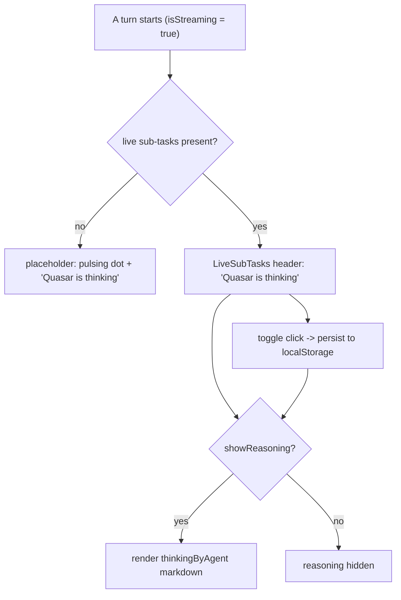

# Quasar Thinking Label and Reasoning Toggle

| | |
|---|---|
| **Version** | 1.3 |
| **Status** | Implemented |
| **Date Created** | 2026-10-20 |
| **Last Updated** | 2026-10-21 |

| Version | Date | Change |
|---|---|---|
| 1.3 | 2026-10-21 | Marked Implemented: the plan shipped in #52. |
| 1.2 | 2026-10-20 | Also retired `TestLiveAgentAsTool_StatusFollowsTheUsersLanguage` and the `status` collection in `summarize` (`backend/test/service/agent/agent_as_tool_live_test.go`) — it asserted the one `status` event per turn that this plan removes. §4 and §8 updated. |
| 1.1 | 2026-10-20 | Made the test retirement explicit (§4, §8): `backend/test/service/agent/chat_status_test.go` is deleted with `announceStatus`, but its unrelated `TestTrustedSources_PromptIsGeneratedFromTheList` (owned by `news-brief-evidence-cards.md`) is relocated to a new `backend/test/service/agent/trusted_sources_test.go` rather than lost. |
| 1.0 | 2026-10-20 | Initial draft. |

## 1. Problem Statement

While a turn starts, the chat shows a placeholder whose words are generated per turn by a small model call (`Orchestrator.announceStatus`) in the language of the user's message, published as a `status` event; the frontend renders it in `ChatThread`'s placeholder. A user chatting in Indonesian sees "Quasar lagi berpikir", in Japanese "クエーサーは考え中…", and so on.

The maintainer wants one fixed English label, `Quasar is thinking`, used globally regardless of the user's language, and wants the reasoning trace behind it to be show/hide-able and remembered across sessions.

Because the label becomes static, `announceStatus` — one extra model call per turn whose only output is that phrase — becomes dead weight and is removed in this plan.

## 2. Definition of Done

1. The placeholder and the live panel both show the fixed English label `Quasar is thinking`; no model call produces it.
2. A global `hide thinking` / `show thinking` control toggles the reasoning trace (the `thinkingByAgent` markdown) for the whole thread.
3. The toggle state is remembered across reloads and chats (`localStorage['pulsar.agent.showReasoning']`).
4. `statusText` state, its resets, the `MessageListProps.statusText` field, and the `event.type === 'status'` branch are gone.
5. Backend: `announceStatus`, `statusInstructions` and `statusTimeout` are deleted, along with the now-unused `log/slog` and `time` imports of that file; no `status` event is published. The `status` variant stays in the frontend event union (unused) so the wire contract is unchanged.
6. AGENTS.md §3 records the carve-out: static English UI-chrome labels are not agentic responses.

## 3. Feature Description

The "thinking" indication has two visuals today: the placeholder shown before the first live event, and the `LiveSubTasks` panel header shown once sub-tasks stream. Both now read `Quasar is thinking` (the header keeps `Finalizing on-chain` and `Composing reply` for those two distinct states). A single control in the panel header shows or hides the reasoning text; its value persists in `localStorage` so a user who does not want to see reasoning never has to hide it twice.

The reasoning content itself is unchanged — it is still Nova's and Comet's streamed `thinking` deltas — only its visibility is now user-controlled.

## 4. Impacted Files

| Layer | Change | File | Reuse check |
|---|---|---|---|
| Frontend | [MODIFY] | `frontend/components/agent/ChatThread.tsx` | Owns the placeholder, `LiveSubTasks`, and the stream event handler |
| Frontend | [MODIFY] | `frontend/http/agent/chatApi.ts` | Owns the `ChatStreamEvent` union (comment only) |
| Backend | [MODIFY] | `backend/src/service/agent/orchestrator_service.go` | Holds the `announceStatus` call site |
| Backend | [MODIFY] | `backend/src/service/agent/orchestrator_stream_service.go` | Holds `announceStatus`, `statusInstructions`, `statusTimeout` |
| Backend | [DELETE] | `backend/test/service/agent/chat_status_test.go` | Its three `TestStatus_*` cases and their `statusTurn`/`recordingModel`/`memoryCheckpointStore` helpers test the removed feature |
| Backend | [NEW] | `backend/test/service/agent/trusted_sources_test.go` | Holds the relocated `TestTrustedSources_PromptIsGeneratedFromTheList` |
| Backend | [MODIFY] | `backend/test/service/agent/agent_as_tool_live_test.go` | Drops `TestLiveAgentAsTool_StatusFollowsTheUsersLanguage` and the `status` collection in `summarize` — both asserted the removed event |
| Docs | [MODIFY] | `AGENTS.md` §3 | Carve-out for static English UI-chrome labels |
| Docs | [MODIFY] | `docs/plans/chat-status-in-user-language.md` | Deprecated (superseded by this plan) |

No new production file, type, interface or table is added.

## 5. Code Shape

### 5.1 `ChatThread.tsx`

```tsx
// NEW — fixed UI-chrome label + remembered visibility (SSR-safe)
const QUASAR_THINKING_LABEL = 'Quasar is thinking';
const REASONING_VISIBILITY_KEY = 'pulsar.agent.showReasoning';

function useReasoningVisibility(): [boolean, (value: boolean) => void] {
  const [show, setShow] = useState(() =>
    typeof window === 'undefined' ? true : window.localStorage.getItem(REASONING_VISIBILITY_KEY) !== 'false');
  const update = useCallback((value: boolean) => {
    setShow(value);
    try { window.localStorage.setItem(REASONING_VISIBILITY_KEY, value ? 'true' : 'false'); } catch { /* ignore */ }
  }, []);
  return [show, update];
}
```

- `LiveSubTasks` gains props `showReasoning: boolean` and `onToggleReasoning: () => void`.
- Header label becomes `isFinalizing ? 'Finalizing on-chain' : anyInProgress ? QUASAR_THINKING_LABEL : 'Composing reply'` (replacing the hardcoded `'Working'`).

```tsx
// BEFORE — header row
<span className="pulsar" />
<span style={{ /* … */ }}>{label}</span>
<span style={{ fontFamily: 'var(--font-mono)', fontSize: 11, color: 'var(--hairline-strong)' }}>{subTasks.length} sub tasks so far</span>

// AFTER — same row, plus the toggle
<span className="pulsar" />
<span style={{ /* … */ }}>{label}</span>
<span style={{ fontFamily: 'var(--font-mono)', fontSize: 11, color: 'var(--hairline-strong)' }}>{subTasks.length} sub tasks so far</span>
<button onClick={onToggleReasoning} style={{ /* … */ }}>
  {showReasoning ? 'hide thinking' : 'show thinking'}
</button>
```

```tsx
// reasoning markdown — gate on the toggle
{showReasoning && thinkingByAgent[subTask.agent] && (
  <div style={{ color: 'var(--ink-soft)' }}>
    <MessageMarkdown content={thinkingByAgent[subTask.agent]} fontSize={12.5} />
  </div>
)}
```

```tsx
// placeholder — BEFORE
<span className="pulsar" />
{statusText && <span style={{ fontSize: 12.5, color: 'var(--body)', fontFamily: 'var(--font-mono)' }}>{statusText}</span>}

// AFTER
<span className="pulsar" />
<span style={{ fontSize: 12.5, color: 'var(--body)', fontFamily: 'var(--font-mono)' }}>{QUASAR_THINKING_LABEL}</span>
```

Removed: `statusText` state, its resets in `handleSend`/`handleRetry`, the `statusText` field in `MessageListProps`, and the `if (event.type === 'status') setStatusText(...)` branch. `useReasoningVisibility()` is called in `ChatThread`; `showReasoning` and `onToggleReasoning` are threaded to `LiveSubTasks`.

### 5.2 `chatApi.ts`

```ts
// [MODIFY, comment only] — the backend no longer publishes this; kept so the
// wire contract and old payloads still type-check.
| { type: 'status'; data: { text: string } }
```

### 5.3 `orchestrator_service.go`

```go
// BEFORE — Send, first lines
func (o *Orchestrator) Send(ctx context.Context, in OrchestratorInput) (OrchestratorResult, error) {
    go o.announceStatus(ctx, in.ChatID, in.RawPrompt)
    // ...
}

// AFTER
func (o *Orchestrator) Send(ctx context.Context, in OrchestratorInput) (OrchestratorResult, error) {
    // ...
}
```

### 5.4 `orchestrator_stream_service.go`

Deleted: `const statusTimeout`, `const statusInstructions`, `func (o *Orchestrator) announceStatus(...)`, and the `"log/slog"` / `"time"` imports that only it used.

Call flow after the change: the turn is unaffected; the frontend shows the fixed label from its first render and never waits for a status call.

### 5.5 Test relocation

`chat_status_test.go` is deleted. Its `TestTrustedSources_PromptIsGeneratedFromTheList` (which belongs to `news-brief-evidence-cards.md`, not to the status feature) is moved verbatim into `trusted_sources_test.go` so that coverage is not lost with the retired feature.

## 6. UI/UX Changes (Lo-Fi)

```
BEFORE
[ (•)                                ]   first moment: dot only
[ (•)  Quasar lagí berpikir…           ]   model's words, user language

AFTER
[ (•)  Quasar is thinking             ]   fixed English, global
[ (•)  Quasar is thinking   ] [hide thinking]  while the panel is streaming
       └─ reasoning trace shown/hidden by the toggle, remembered in localStorage
```

## 7. Flowchart



## 8. Verification Plan

### Automated
1. `cd frontend && npx tsc --noEmit` — clean.
2. `cd frontend && npx eslint components/agent/ChatThread.tsx` — no new problems beyond the repo's pre-existing baseline.
3. `cd backend && go build ./... && go vet ./...` — clean.
4. `grep -rn "announceStatus\|statusInstructions\|statusTimeout" backend/src` — no matches.
5. `grep -rn "statusText" frontend/` — no matches.
6. `cd backend && go test ./test/service/agent/ -run 'TestTrustedSources' -race` — the relocated test still passes; no `TestStatus_*` remains.
7. `grep -rn 'TestLiveAgentAsTool_StatusFollowsTheUsersLanguage\|case "status"' backend/test` — no matches.

### Manual
1. Send a message in English, Indonesian and Japanese: the placeholder reads `Quasar is thinking` in all three.
2. Toggle `hide thinking` while a turn streams: the reasoning markdown collapses; `show thinking` restores it.
3. Reload the page: the toggle state is remembered.
4. Open a different chat: the toggle state carries over (global preference).

### Note
- No frontend test harness exists for `ChatThread.tsx`; coverage is `tsc`/`eslint` plus the manual pass.
