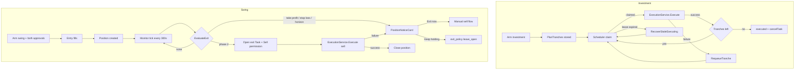

# Swing & Investment Strategy Execution

| | |
|---|---|
| **Version** | 1.2 |
| **Status** | Draft |
| **Date Created** | 2026-10-25 |
| **Last Updated** | 2026-10-25 |

| Version | Date | Change |
|---|---|---|
| 1.2 | 2026-10-25 | Added the double-fill proof to §9.1/§9.3: Task 436 was armed with 200,000 raw of budget while the decision sized 1,000 IDRX, two concurrent `/execute` calls both filled (trades 25 and 26, 100,000 raw each), both returned 200, and `route_to_executor`/`decide`/`execute`/`sync_database` were recorded twice with duplicate `step_order`. Reordered §9.5 so the per-task in-flight guard is first (fund safety). §5.4's recurring branch now also requires `status == "armed"`, so a manual execute cannot race the scheduler claim. |
| 1.1 | 2026-10-25 | Added the measured production baseline from `pulsarfi-api.fly.dev` to §1.3 and §9: single greeting 8.77s, trade-intent turn 20.85s, arm 3.04s, execute 28.07s (≈82% LLM, ≈18% chain), three concurrent arms 4.67–6.23s, two of three concurrent trade turns failed at the LLM step after `route_decision`, and two concurrent executes on one Task both ran the full pipeline (duplicate `route_to_executor`/`decide`, one trade). No change to the feature design in §2–§8. |
| 1.0 | 2026-10-25 | Initial draft. Folds `swing-trade-auto-exit-and-monitoring.md` v1.0 into this plan and adds the investment (DCA) execution loop. Rejects the `AgentTaskManager` redeploy that plan required: phase 2 reaches automatic swing exits through a companion exit Task created at trigger time, using only existing contract functions. |

---

## 1. Problem Statement

Both shapes are collected and stored end-to-end, but neither is executed as a strategy. The agent can only ever fire one trade per armed Task.

### 1.1 Investment is a single fill, not a DCA plan

The UI collects the DCA parameters, `ArmTask` persists them, and `AgentTaskManager` already enforces a per-trade cap, a cooldown and a total budget across multiple fills. Every layer except the scheduler loop is ready. The loop is dead for three independent reasons:

1. **Status gate.** `FindDueRecurringTasks` only selects `status = 'armed'` (`backend/src/repository/agent_task_repository.go:174-181`), while `reconcileTradeStatus` flips the Task to `executed` after the first fill (`backend/src/service/agent/task/task_service.go`). Tranche 2 is never selected again.
2. **No resumable turn.** `ExecuteTask` delegates to `Orchestrator.ResumeExecute`, which requires a pending `ArmInterrupt` in the chat checkpoint (`backend/src/service/agent/orchestrator/orchestrator_service.go`). When the first resumed turn finishes, `finishInterrupt` clears both the checkpoint and the interrupt marker (`backend/src/service/agent/orchestrator/stream_service.go:251-253`). A later scheduler tick has nothing to resume, so even a status fix would fail with `ErrNoPendingExecution`.
3. **Stale schedule.** `UpdateNextRunAt` exists but has zero callers (verified by grep). `next_run_at` is written once at arm and never advanced.

Two secondary defects sit on the same path:

- `agent_tasks.max_per_trade` is `BIGINT` and parsed with `big.Int.Int64()` in `ArmTask`. A Sell tranche cap is denominated in stock-token raw units (18 decimals), so any cap above ~9.22 whole tokens overflows/truncates before it reaches the contract.
- An investment Task with `is_recurring = true` and `cooldown_interval = 0` stores `next_run_at = NULL`, so `next_run_at <= NOW()` can never match. The UI allows exactly that combination.

Net: an "investment" Task is one buy or sell with a 30-day permission, then nothing.

### 1.2 Swing has no monitoring, only one reminder

A swing Task stores `horizon_expires_at` and the scheduler sends one H-1 card. Between entry and horizon nothing observes the position:

- There is no position record: no entry price, no quantity, no cost basis, no take-profit or stop-loss. `agent_trades` stores the fill amount only for IDRX-equivalent display, not a position.
- `TaskService.Evaluate` does not exist; no deterministic price evaluation tick exists anywhere.
- `HorizonNoticeCard`'s "Exit Position" only sends a chat prompt, which opens a fresh sell flow with a new arm and a new wallet approval. It is a reminder, not an exit mechanism.
- "Keep in Portfolio" calls `SettleHorizonTask`, which updates only the database; the on-chain permission stays live (`backend/src/service/agent/task/task_service.go`).
- `FindPendingHorizonTasks` filters only on `horizon_expires_at` and `horizon_notified_at`; it does not exclude paused, executed or settled tasks, and it treats investment as a swing position ("your swing position" copy for a DCA plan that is still accumulating).

Net: swing is a scalp with a longer permission expiry plus one reminder.

### 1.3 Execution latency is inherited, and the strategy paths must not make it worse

A live measurement against `pulsarfi-api.fly.dev` on 2026-10-25 (§9) puts one scalp execute at 28.07s: roughly 82% of it is model time across Quasar's resume, Comet's tool loop and Quasar's final reply; roughly 18% is the five agent-signed transactions and their receipts. The backend still has no internal timing logs, so this split comes from external request timing plus block timestamps, not from the app's own instrumentation. That path is out of scope for this plan and is tracked as a separate workstream (§9). Swing and investment triggers are minutes-scale, so the design here uses the existing 30-second pool price cache and a 300-second monitor tick instead of adding a second hot path. No new per-tick chain writes are introduced.

---

## 2. Definition of Done

### Phase 1 — both shapes, no contract change

- [ ] A recurring (investment) Task executes tranche `N+1` after `cooldown_sec` with no chat turn, no user action and no second arm.
- [ ] The loop stops cleanly when any of these is true: `tranches_done >= tranche_count`, remaining on-chain budget is zero, the permission has expired, the task is paused, or the task is cancelled/disarmed.
- [ ] A tranche is claimed with one atomic Postgres statement, so two backend instances cannot execute the same tranche.
- [ ] A crashed `executing` Task is recovered back to `armed` after a fixed lease instead of staying stuck forever.
- [ ] `next_run_at` advances on every claim and the task exits `executing` on both success and failure.
- [ ] `tranches_done` and `tranche_count` are exposed to the frontend; the Tasks tab shows `n of m` for recurring Tasks.
- [ ] `max_per_trade` is stored as `NUMERIC(78,0)`; a Sell cap above 9.22 tokens round-trips without truncation.
- [ ] Every executed swing buy creates exactly one open position row with entry price, quantity raw, cost basis, horizon and optional TP/SL.
- [ ] A monitor tick evaluates every open position against the live pool spot price and the horizon, and emits at most one notice per `(position, signal)` per 24 hours.
- [ ] The notice content and every card label are authored by the model in the user's active language (AGENTS §3); no Go string literal is rendered to the user.
- [ ] H-1 notices apply to swing only, skip paused/executed/settled Tasks, and reuse the position's own signal instead of firing unconditionally.
- [ ] "Leave" on the H-1 card cancels the entry Task on-chain so no permission headroom remains usable.
- [ ] No `AgentTaskManager` change, no redeploy, no ABI rewire.

### Phase 2 — automatic swing exit

- [ ] Arming a swing buy requests two wallet approvals in one flow: IDRX for the entry and the stock token for the future exit. No wallet prompt occurs later in the position's life.
- [ ] The stock allowance is bounded: expected quantity at the live pool price plus a 2% buffer, never an unlimited approval.
- [ ] When TP, SL or the horizon is reached, the monitor creates a companion exit Task (database row + on-chain `createTask` + Sell `grantTradePermission`) and executes the sell through the same execution service Comet uses.
- [ ] The exit is sized to the real received quantity, not to the pre-entry estimate; the position row is the source of truth.
- [ ] On success the position is closed, the exit Task is `executed`, and `agent_trades` + `stock_transactions` rows exist for the sell.
- [ ] On `AllowanceExceeded`, expired permission, or any execution error, the position stays open, the failure is logged with `task=<id> chat=<uuid>` (AGENTS §8.7), and a manual notice is sent. No silent failure.
- [ ] The companion exit Task is filtered out of the normal Task list; it is rendered inside the position card.
- [ ] Settlement/leave cancels any live exit permission.

### Out of scope

- On-chain TP/SL guardrails, OCO semantics, price-condition reverts.
- `AgentTaskManager` redeploy or any `smart-contract/src/**` change.
- A deterministic indicator engine (moving averages, support/resistance, consolidation score). The existing plan proposed it; it is not required to deliver position tracking and a price-threshold exit.
- Scalp latency remediation (§9).

---

## 3. Feature Description

### 3.1 Investment state machine

```
arm ─────────────► armed ◄──────────────────────────────┐
                    │                                   │
          claim (atomic UPDATE)                         │
                    ▼                                   │
                 executing ── success, tranches left ───┘
                    │
                    ├── success, tranches_done == count ─► executed (+ cancelTask)
                    ├── failure ─────────────────────────► armed (retry after 60s)
                    └── lease expired (> 10 min) ───────► armed
```

- `armed` means "waiting for the next tranche", not "waiting for the first arm". `armed_at` remains the on-chain permission timestamp.
- `executing` is a new `agent_tasks.status` value. It exists only for the duration of one tranche and is the claim lease.
- `executed` remains the terminal state for both single-shot and completed recurring Tasks. The existing `alreadyExecutedResult` guard is kept for single-shot Tasks only.

**Tranche sizing.** Deterministic, computed once at arm and stored, so the scheduler never has to ask a model how much to spend:

| Input | Rule |
|---|---|
| `max_amount_per_trade` provided | `tranche_size = max_amount_per_trade` |
| Not provided, `cooldown_sec > 0`, `duration_sec > 0` | `count = clamp(duration / cooldown, 1, 24)`; `tranche_size = total_budget / count` |
| Not provided, no cooldown | `count = 1`; all at once |

`tranche_count = ceil(total_budget / tranche_size)`, capped at 24. Each run spends `min(tranche_size, remaining permission)`; when `tranches_done + 1 == tranche_count` it spends the full remaining budget, so integer division never strands funds. Both values are stored on `agent_tasks`, and the raw budget is IDRX raw (2 dp) for a buy and stock raw (18 dp) for a sell.

**Tranche execution.** The scheduler does not resume a chat checkpoint. It builds a `RunContext` with a fresh `SubTaskRecorder` (which continues the same hash chain), asks the model for one short label/reasoning sentence in the user's language, and calls the extracted `executor.ExecutionService` with an already-raw amount. The service records `decide` on-chain, calls `executeTrade`, records `execute` and `sync_database`, and inserts `agent_trades` + `stock_transactions` exactly as Comet's `submit_trade` does.

**Frontend.** Investment horizon is no longer hardcoded to 30 days: the ArmPanel offers 30/90/180 days (the value the user already expressed in chat pre-fills the picker). `PlanCard`/`TaskDetail` show `tranche n of m` and the next run time.

### 3.2 Swing position tracking

A position is created by the execution service after a successful swing **buy** fill. It is derived from the contract's own `TradeExecuted` record, not re-quoted:

- `entry_price_idrx` = `fill.Amount / fill.ReceivedAmount` expressed as raw IDRX per whole stock.
- `quantity_raw` = `fill.ReceivedAmount` (18 dp).
- `cost_basis_idrx` = `fill.Amount` (2 dp).
- `horizon_expires_at` = the Task's `horizon_expires_at`.
- `take_profit_idrx` / `stop_loss_idrx` = copied from the Task row written at arm, so the value the user confirmed on the card is the value the monitor enforces. Both are optional and empty when the user set none. The backend never invents thresholds.

A swing **sell** does not create a position; it would be a closing action and the opening position keeps its own lifecycle.

### 3.3 Position monitor

A new tick runs every 300 seconds (configurable) inside the existing `TaskScheduler`, after the recurring-tranche pass:

1. `FindOpen` returns positions with `status = 'open'`.
2. For each, read the live pool price through `PriceService.GetOnchainPriceV4` (already cached for 30 seconds). No new price source is introduced.
3. `agentcore.EvaluateExit` decides the signal: `stop_loss` if the price is at or below the stop, `take_profit` if at or above the target, `horizon` if `now >= horizon_expires_at`. Stop-loss wins if a gap crosses both, because it is the risk-reducing side.
4. On a signal, the position row records `last_signal` + `last_notified_at` and the monitor sends one notice. The same signal for the same position is not re-sent within 24 hours; a different, later signal can notify immediately.
5. Phase 1: the notice offers "Exit now" (sends the existing close prompt through chat) and "Keep holding" (records `exit_policy = leave_open`). Phase 2: the notice is sent only after an automatic exit attempt has failed.

The notice is a `PositionNoticeCard` chat message, created exactly like the existing `HorizonNoticeCard`: one `Model.Generate` call returns both the chat sentence and every card label in the user's language, based on the last ten chat messages. No Go literal is rendered.

### 3.4 H-1 notice cleanup

`processHorizonNotices` is narrowed to `shape == "swing"` and to Tasks whose status is still `armed` or `executed` with an open position. Investment no longer receives "your swing position is nearing horizon" copy; when the last tranche completes, the investment Task gets a completion message from the tranche executor instead. "Leave" calls `Chain.CancelTask` before `SetExitPolicy`, so the on-chain permission cannot be used after the user has opted out.

### 3.5 Phase 2 — automatic exit without a contract change

`AgentTaskManager.executeTrade` checks the live ERC-20 allowance, the per-task budget and the cooldown. A Task has exactly one `TradePermission`, and the entry permission's budget is IDRX-denominated while a Sell consumes stock-denominated units. Reusing the entry permission for the exit would mix two units in one `usedBudget`, which is why the earlier draft proposed a dual-permission contract change.

This plan avoids the redeploy by creating a **companion exit Task at trigger time**:

1. At arm, the ArmPanel approves the stock token for `AgentTaskManager` with `expected_quantity + 2%`, where `expected_quantity` is derived from the confirmed budget and `quoteStockToIdrx(ticker, 1e18)`.
2. On a TP/SL/horizon signal, the monitor inserts a new `agent_tasks` row with `purpose = 'swing_exit'`, `parent_task_id = position.task_id`, `is_actionable = true`, `status = 'armed'`, and the same wallet. It then calls `createTask` + `grantTradePermission` (Sell, budget = `position.quantity_raw`, duration = 1 hour, no per-trade cap, no cooldown). Both are agent-signed; no wallet prompt.
3. It records the `decide` subtask against the new on-chain Task, calls `executeTrade` with the real quantity, then records `execute` and `sync_database`.
4. It closes the position and marks the exit Task `executed`.

The entry Task is untouched, so its history and permission remain auditable. The exit Task is excluded from the Tasks tab (`purpose = 'swing_exit'`) and rendered inside the position card.

If the actual fill exceeded the approved allowance (slippage above the 2% buffer), or the allowance was revoked, `executeTrade` reverts with `AllowanceExceeded`. The monitor catches it, leaves the position open, logs the error, and sends the manual notice. The user can still close manually.

### 3.6 Alternatives considered and rejected

| Option | Why rejected |
|---|---|
| Redeploy `AgentTaskManager` with TP/SL guardrails and dual permissions (the earlier draft plan) | Requires a fresh address, `AGENT_ROLE` re-grant, backend/frontend address rewire and an EIP-170 size check. The same user-visible outcome is reachable with existing functions. |
| Call Comet's LLM once per tranche to size it | Adds one model round-trip per cooldown and one more nondeterministic input to a mechanical schedule. Sizing is fixed at arm and stored. |
| Process-wide mutex or advisory lock for tranche claims | The mutex is per-process and production can run more than one machine; an advisory lock is heavier than the single atomic `UPDATE ... RETURNING` that already fits the requirement. |
| Reuse `ExecuteTask`/`ResumeExecute` for tranches | The Arm checkpoint is consumed by the first resumed turn; there is nothing left to resume. |
| Keep H-1 for investment | An accumulating DCA plan is not a position nearing expiry; the copy is wrong and the card's actions do not match the strategy. |
| Notify-only swing (no auto exit) | Delivers no automation beyond today's reminder. Phase 1 still ships the notice, but phase 2 fulfils the shape's promise. |

---

## 4. Impacted Files

### 4.1 Backend

| File | Change | Reuse check |
|---|---|---|
| `backend/migrations/027_add_strategy_execution.sql` | `[NEW]` `agent_positions`; `agent_tasks.tranche_size NUMERIC(78,0)`, `tranche_count`, `tranches_done`, `take_profit_idrx NUMERIC(78,0)`, `stop_loss_idrx NUMERIC(78,0)`, `parent_task_id`, `purpose DEFAULT 'trade'`; alter `max_per_trade` to `NUMERIC(78,0)`; indexes on `(status, next_run_at)` and `(status, horizon_expires_at)`. | Checked `024_add_standing_order_and_horizon_guardrails.sql`: it already added the DCA/horizon columns, so this migration only adds what is missing plus the position table. No new table where a column would do. |
| `backend/src/model/agent_position.go` | `[NEW]` GORM model for one open/closed position. | `agent_trades` is one row per fill with no entry price, quantity, TP/SL or state; `stock_transactions` is an activity ledger. Neither can answer "which positions are open and what are their thresholds". |
| `backend/src/model/agent_task.go` | `[MODIFY]` `MaxPerTrade int64` → `string`; add `TrancheSize string`, `TrancheCount int32`, `TranchesDone int32`, `TakeProfitIDRX string`, `StopLossIDRX string`, `ParentTaskID *int64`, `Purpose string`. | Existing standing-order fields are kept; only the lossy type changes. |
| `backend/src/repository/agent_position_repository.go` | `[NEW]` `Create`, `FindOpen`, `MarkSignal`, `Close`. | No existing repository owns per-position state. |
| `backend/src/repository/agent_task_repository.go` | `[MODIFY]` replace `FindDueRecurringTasks` with `ClaimDueRecurringTasks`; add `FinishTranche`, `RequeueTranche`, `RecoverStaleExecuting`; delete `UpdateNextRunAt`. | The claim reuses the existing partial index from migration 024. |
| `backend/src/app/core/agent/tranche.go` | `[NEW]` `PlanTranches`, pure and I/O-free. | `app/helpers.go` has text/hash helpers, no trading policy; `contracts/agent.go` is transport DTOs. Per AGENTS §8.1, policy belongs in `core`. |
| `backend/src/app/core/agent/position.go` | `[NEW]` `Position`, `ExitSignal`, `EvaluateExit`. | Same reason. Pure price/threshold comparison, no clock or repository. |
| `backend/src/service/agent/executor/execution_service.go` | `[NEW]` `ExecutionService`, `ExecutionRequest`, `ExecutionResult`, `PositionRecorder` port. | The logic already exists inside `newSubmitTradeTool`'s closure; this extracts it so the tool and the scheduler share one implementation instead of duplicating on-chain-first recording and unit conversion. |
| `backend/src/service/agent/executor/tools_service.go` | `[MODIFY]` `submit_trade` becomes a thin wrapper over `ExecutionService`; amount scaling moves into the service. | Removes the only duplicated copy. |
| `backend/src/service/agent/executor/index.go` | `[MODIFY]` `New` builds `ExecutionService` and passes it to the tool. | Signature only. |
| `backend/src/service/agent/position/monitor_service.go` | `[NEW]` `PositionMonitor` tick, notice authoring, phase-2 exit orchestration. | `scheduler_service.go` already owns ticks and will call it; `analyzer/` is LLM-driven analysis, not a deterministic loop. |
| `backend/src/service/agent/task/task_service.go` | `[MODIFY]` `ExecuteTask` routes recurring Tasks to `executeRecurringTranche`; `ArmTaskInput` gains `take_profit_idrx` / `stop_loss_idrx`; `ArmTask` computes and stores the tranche plan, stores `max_per_trade` as a string, and persists TP/SL; `SettleHorizonTask` cancels the entry Task. | Existing arm path is reused; no second arm endpoint. |
| `backend/src/service/agent/task/scheduler_service.go` | `[MODIFY]` use the atomic claim, recover stale leases, run the monitor tick, gate H-1 to swing. | Same 60-second scheduler; the monitor uses its own 300-second counter. |
| `backend/src/service/agent/orchestrator/workflow_service.go` | `[MODIFY]` export `DecisionFromTask`; carry optional TP/SL through the card for display only (the authoritative values are the arm request). | The parser already exists; only visibility and two display fields change. |
| `backend/src/service/agent/supervisor/instructions.go` | `[MODIFY]` ask for TP/SL and the investment horizon during intake, so the ArmPanel pre-fills them. | Additive prompt fields only. |
| `backend/src/service/agent/executor/instructions.go` | `[MODIFY]` state that a recurring Task's tranche size is fixed server-side; do not re-plan it per tranche. | Prevents the model from contradicting the stored plan. |
| `backend/src/service/agent_registry.go` | `[MODIFY]` wire `ExecutionService`, `PositionMonitor`, new TaskService fields. | Existing registry is the single wiring point (AGENTS taste: explicit registry, no DI container). |
| `backend/src/http/handlers/agent/tasks.go` | `[MODIFY]` expose `tranches_done`/`tranche_count`/`next_run_at` (already the Task JSON) and filter `purpose = 'swing_exit'` from `ListTasks`. | No new endpoint. |
| `backend/src/config/onchain.go` | `[MODIFY]` add optional `POSITION_MONITOR_INTERVAL_SEC` (default 300). | Env validation lives in `config` only (AGENTS taste). |

### 4.2 Frontend

| File | Change |
|---|---|
| `frontend/components/agent/ArmPanel.tsx` | `[MODIFY]` investment horizon picker (30/90/180d); swing second approval for the stock token with a bounded amount and its own progress state. |
| `frontend/components/agent/SwingPositionCard.tsx` | `[NEW]` entry, live price, P&L, TP/SL, horizon, state, exit progress. Checked `TradeLedger.tsx` (fill list) and `HorizonNoticeCard.tsx` (one-shot notice); neither represents an open position. |
| `frontend/components/agent/PositionNoticeCard.tsx` | `[NEW]` signal card with Exit/Keep actions. Checked `HorizonNoticeCard.tsx`; the payload and actions differ (signal + live P&L vs. H-1 countdown), and reusing it would make the H-1 component carry two contracts. |
| `frontend/components/agent/PlanCard.tsx` | `[MODIFY]` render the position card for swing Tasks and `tranche n of m` for recurring Tasks. |
| `frontend/components/agent/TaskDetail.tsx` | `[MODIFY]` map `executing`, `executed`, `settled_held` and `tranche n of m`. |
| `frontend/components/agent/QuasarPanel.tsx` | `[MODIFY]` render open positions in the Tasks tab. |
| `frontend/http/agent/taskApi.ts`, `hooks.ts` | `[MODIFY]` `AgentTask` gains the tranche/TP-SL fields; `ArmTaskParams` gains `take_profit_idrx` / `stop_loss_idrx` (display value converted to raw at the call site); positions query + realtime topic. |
| `frontend/components/agent/cardContract.ts` | `[MODIFY]` optional labels for TP/SL, exit allowance, tranche progress. |

### 4.3 Smart contract

No change. `AgentTaskManager.createTask`, `grantTradePermission`, `executeTrade`, `cancelTask` and `TradePermissions` already cover every call this plan makes. `PulsarProtocol.quoteStockToIdrx` is read-only and already used by the frontend.

---

## 5. Code Shape

Snippets are contracts, not final code. Anything not yet exercised against a running test is marked `UNVERIFIED`.

### 5.1 New core types

```go
// backend/src/app/core/agent/tranche.go
// PlanTranches splits an approved budget into deterministic equal tranches.
// totalBudgetRaw and maxPerTradeRaw are raw on-chain units for the Task's side.
func PlanTranches(totalBudgetRaw, maxPerTradeRaw string, duration, cooldown time.Duration) (TranchePlan, error)

type TranchePlan struct {
    SizeRaw string // raw units per tranche
    Count   int
}
```

```go
// backend/src/app/core/agent/position.go
// EvaluateExit is pure: no I/O, no clock parameter defaulting.
// priceIDRXPerWholeStock is raw IDRX (2 dp) per whole stock.
func EvaluateExit(p Position, priceIDRXPerWholeStock string, now time.Time) ExitSignal

type ExitSignal string

const (
    ExitNone       ExitSignal = ""
    ExitTakeProfit ExitSignal = "take_profit"
    ExitStopLoss   ExitSignal = "stop_loss"
    ExitHorizon    ExitSignal = "horizon"
)

type Position struct {
    ID               int64
    TaskID           int64
    Wallet           string
    Ticker           string
    EntryPriceIDRX   string
    QuantityRaw      string
    CostBasisIDRX    string
    TakeProfitIDRX   string
    StopLossIDRX     string
    HorizonExpiresAt time.Time
    ExitTaskID       *int64
    LastSignal       ExitSignal
    LastNotifiedAt   *time.Time
}
```

### 5.2 Model and repository

```go
// backend/src/model/agent_position.go
type AgentPosition struct {
    ID               int64      `gorm:"column:id;primaryKey"`
    TaskID           int64      `gorm:"column:task_id"`
    WalletAddress    string     `gorm:"column:wallet_address"`
    Ticker           string     `gorm:"column:ticker"`
    StockID          int64      `gorm:"column:stock_id"`
    EntryPriceIDRX   string     `gorm:"column:entry_price_idrx;type:numeric(78,0)"`
    QuantityRaw      string     `gorm:"column:quantity_raw;type:numeric(78,0)"`
    CostBasisIDRX    string     `gorm:"column:cost_basis_idrx;type:numeric(78,0)"`
    TakeProfitIDRX   string     `gorm:"column:take_profit_idrx;type:numeric(78,0);default:''"`
    StopLossIDRX     string     `gorm:"column:stop_loss_idrx;type:numeric(78,0);default:''"`
    HorizonExpiresAt *time.Time `gorm:"column:horizon_expires_at"`
    Status           string     `gorm:"column:status;default:'open'"`
    ExitTaskID       *int64     `gorm:"column:exit_task_id"`
    LastSignal       string     `gorm:"column:last_signal;default:''"`
    LastNotifiedAt   *time.Time `gorm:"column:last_notified_at"`
    ClosedAt         *time.Time `gorm:"column:closed_at"`
}
```

`AgentTask` changed fields (before → after):

```go
// before
MaxPerTrade int64 `gorm:"column:max_per_trade;default:0" json:"max_per_trade"`

// after
MaxPerTrade     string `gorm:"column:max_per_trade;type:numeric(78,0);default:0" json:"max_per_trade"`
TrancheSize     string `gorm:"column:tranche_size;type:numeric(78,0);default:0" json:"tranche_size"`
TrancheCount    int32  `gorm:"column:tranche_count;default:0" json:"tranche_count"`
TranchesDone    int32  `gorm:"column:tranches_done;default:0" json:"tranches_done"`
TakeProfitIDRX  string `gorm:"column:take_profit_idrx;type:numeric(78,0);default:0" json:"take_profit_idrx"`
StopLossIDRX    string `gorm:"column:stop_loss_idrx;type:numeric(78,0);default:0" json:"stop_loss_idrx"`
ParentTaskID    *int64 `gorm:"column:parent_task_id" json:"parent_task_id,omitempty"`
Purpose         string `gorm:"column:purpose;default:'trade'" json:"purpose"`
```

`ArmTaskInput` after:

```go
type ArmTaskInput struct {
    TotalBudget       string `json:"total_budget"`
    DurationSec       int64  `json:"duration_sec"`
    TokenAddress      string `json:"token_address"`
    MaxAmountPerTrade string `json:"max_amount_per_trade,omitempty"`
    CooldownInterval  uint32 `json:"cooldown_interval,omitempty"`
    IsRecurring       bool   `json:"is_recurring,omitempty"`
    TakeProfitIDRX    string `json:"take_profit_idrx,omitempty"` // raw IDRX per whole stock
    StopLossIDRX      string `json:"stop_loss_idrx,omitempty"`   // raw IDRX per whole stock
}
```

`SetArmedWithGuardrails` after:

```go
func (r *AgentTaskRepository) SetArmedWithGuardrails(ctx context.Context, input SetArmedInput) error

type SetArmedInput struct {
    TaskID            int64
    ArmedAt           time.Time
    IsRecurring       bool
    CooldownSec       int32
    MaxPerTrade       string
    TrancheSize       string
    TrancheCount      int32
    TakeProfitIDRX    string
    StopLossIDRX      string
    NextRunAt         *time.Time
    HorizonExpiresAt  *time.Time
}
```

The parameter object keeps the call site readable: the existing seven-argument function would otherwise grow to eleven.

```go
// backend/src/repository/agent_position_repository.go
func (r *AgentPositionRepository) Create(ctx context.Context, input AgentPositionCreateInput) (model.AgentPosition, error)
func (r *AgentPositionRepository) FindOpen(ctx context.Context, limit int) ([]model.AgentPosition, error)
func (r *AgentPositionRepository) MarkSignal(ctx context.Context, id int64, signal string, notifiedAt time.Time) error
func (r *AgentPositionRepository) Close(ctx context.Context, id int64, exitTaskID *int64, closedAt time.Time) error
```

### 5.3 Atomic claim — `agent_task_repository.go`

Before:

```go
func (r *AgentTaskRepository) FindDueRecurringTasks(ctx context.Context, limit int) ([]model.AgentTask, error) {
    var tasks []model.AgentTask
    err := r.DB.WithContext(ctx).
        Where("is_recurring = ? AND status = ? AND paused = ? AND next_run_at <= NOW()", true, "armed", false).
        Order("next_run_at ASC").Limit(limit).Find(&tasks).Error
    return tasks, err
}
```

After:

```go
// ClaimDueRecurringTasks atomically moves due tranches to 'executing' and
// advances next_run_at, so two instances cannot claim the same tranche.
func (r *AgentTaskRepository) ClaimDueRecurringTasks(ctx context.Context, limit int) ([]model.AgentTask, error) {
    var tasks []model.AgentTask
    err := r.DB.WithContext(ctx).Raw(`
        UPDATE agent_tasks
        SET status = 'executing',
            next_run_at = NOW() + (cooldown_sec * interval '1 second')
        WHERE id IN (
            SELECT id FROM agent_tasks
            WHERE is_recurring = TRUE AND status = 'armed' AND paused = FALSE
              AND next_run_at IS NOT NULL AND next_run_at <= NOW()
            ORDER BY next_run_at
            LIMIT ?
            FOR UPDATE SKIP LOCKED
        )
        RETURNING *`, limit).Scan(&tasks).Error
    return tasks, err
}

// FinishTranche records the outcome. done=true cancels the remaining schedule.
func (r *AgentTaskRepository) FinishTranche(ctx context.Context, id int64, done bool) error

// RequeueTranche returns a failed tranche to 'armed' with a short retry delay.
func (r *AgentTaskRepository) RequeueTranche(ctx context.Context, id int64, retryIn time.Duration) error

// RecoverStaleExecuting returns leases older than olderThan to 'armed'.
func (r *AgentTaskRepository) RecoverStaleExecuting(ctx context.Context, olderThan time.Duration) (int64, error)
```

`UNVERIFIED`: GORM's `Raw(...).Scan(&[]model.AgentTask)` mapping of `RETURNING *`; the verification plan resolves it with the claim test in §8. If GORM cannot scan the `NUMERIC` columns into strings through `RETURNING *`, the fallback is a two-step `SELECT ... FOR UPDATE SKIP LOCKED` + `UPDATE` inside one transaction.

### 5.4 `TaskService.ExecuteTask` — before/after

Before:

```go
func (s *TaskService) ExecuteTask(ctx context.Context, taskID int64, wallet string) (agentcore.ExecuteTaskResult, error) {
    // ownership / actionable / armed checks ...
    if task.Status == "executed" {
        return s.alreadyExecutedResult(ctx, task)
    }
    if s.Orchestrator == nil { /* ... */ }
    // ...
    res, err := s.Orchestrator.ResumeExecute(ctx, taskID, wallet)
    // ...
    status, executedTrades := s.reconcileTradeStatus(ctx, taskID, task.Status, countBefore)
    // ...
}
```

After:

```go
func (s *TaskService) ExecuteTask(ctx context.Context, taskID int64, wallet string) (agentcore.ExecuteTaskResult, error) {
    // ownership / actionable / armed checks unchanged ...
    if task.IsRecurring {
        switch task.Status {
        case "armed":
            return s.executeRecurringTranche(ctx, task)
        case "executed":
            return s.alreadyExecutedResult(ctx, task)
        default: // executing, cancelled, settled
            return agentcore.ExecuteTaskResult{}, agentcore.ErrTaskNotArmed
        }
    }
    if task.Status == "executed" {
        return s.alreadyExecutedResult(ctx, task)
    }
    // single-shot path unchanged ...
}
```

New:

```go
// executeRecurringTranche runs exactly one tranche. It never resumes a chat
// checkpoint: the arm pause was consumed by the first fill. On the final
// tranche it calls Chain.CancelTask so no permission headroom remains usable.
func (s *TaskService) executeRecurringTranche(ctx context.Context, task model.AgentTask) (agentcore.ExecuteTaskResult, error)

// trancheLabel asks the model for one short sentence in the user's active
// language; never a Go literal (AGENTS §3).
func (s *TaskService) trancheLabel(ctx context.Context, task model.AgentTask) (string, error)
```

### 5.5 Execution service extraction — `executor/execution_service.go`

Before (inside the `newSubmitTradeTool` closure): ticker validation → `TradePermissionRemaining` → display-to-raw heuristics → clamp → `Record(decide)` → spot price → `convertTradeAmounts` → `ExecuteTrade` → `Record(execute)` → `agent_trades` → `stock_transactions` → `Record(sync_database)`.

After:

```go
type ExecutionRequest struct {
    Ticker    string
    Side      contracts.TradeSide
    Amount    string // display units unless AmountRaw is true
    AmountRaw bool   // true: already in the on-chain unit for Side
    Label     string
    Reasoning string
}

type ExecutionResult struct {
    TxHash  string
    TradeID uint64
    Fill    *agentcore.ExecuteTradeOutput
}

type ExecutionService struct {
    Exec              TaskExecutor
    Stocks            StockLookup
    Prices            SpotPriceReader
    Trades            TradeRecorder
    StockTransactions StockTransactionRecorder
    Positions         PositionRecorder // nil disables position tracking
    IdrxAddress       string
}

func (s *ExecutionService) Execute(ctx context.Context, run *agentcore.RunContext, req ExecutionRequest) (ExecutionResult, error)
```

```go
// PositionRecorder is the execution service's narrow port; the repository
// implements it, the executor package stays free of Postgres.
type PositionRecorder interface {
    RecordEntry(ctx context.Context, taskID int64, wallet string, stock dbmodel.Stock, fill *agentcore.ExecuteTradeOutput) error
}
```

Inside `Execute`, the raw path must not re-enter the display heuristic — a tranche amount is already in the on-chain unit and must be sent unchanged:

```go
parsed, ok := new(big.Int).SetString(chosenAmount, 10)
if !ok { /* reject */ }

var chainAmount, minimumOutputAmount *big.Int
if req.AmountRaw {
    chainAmount = parsed
    minimumOutputAmount = big.NewInt(1) // same floor Comet's path uses today
} else {
    spotPrice, err := s.Prices.OnchainSpotPrice(ctx, stock.Ticker)
    // ...
    chainAmount, minimumOutputAmount, err = convertTradeAmounts(req.Side, parsed, spotPrice)
}
```

The tool after:

```go
func newSubmitTradeTool(execution *ExecutionService) (tool.InvokableTool, error) {
    return utils.InferTool("submit_trade", "...", func(ctx context.Context, req submitTradeRequest) (submitTradeResponse, error) {
        run, ok := agentcore.RunContextFrom(ctx)
        // ... run/arm checks ...
        out, err := execution.Execute(ctx, run, ExecutionRequest{
            Ticker: req.Ticker, Side: side, Amount: req.Amount,
            Label: req.Label, Reasoning: req.Reasoning,
        })
        if err != nil {
            return submitTradeResponse{}, err
        }
        return submitTradeResponse{TxHash: out.TxHash}, nil
    })
}
```

The position is recorded inside `Execute` after the fill, only when all three hold: `Positions != nil`, `run.Decision.Shape == "swing"`, and `side == buy`. A failure to record the position is logged, not returned: the trade is already on-chain, and rolling back is impossible.

### 5.6 Position monitor — `position/monitor_service.go`

```go
type PositionMonitor struct {
    Positions    *repository.AgentPositionRepository
    Tasks        *repository.AgentTaskRepository
    SubTasks     *repository.AgentSubTaskRepository
    ChatMessages *repository.AgentChatMessageRepository
    Chats        *repository.AgentChatRepository
    Prices       executor.SpotPriceReader
    Execution    *executor.ExecutionService
    Chain        ExitChainClient
    Model        model.BaseChatModel
}

type ExitChainClient interface {
    CreateTask(ctx context.Context, owner string, isActionable bool, summary string, promptHash [32]byte) (uint64, error)
    GrantTradePermission(ctx context.Context, onChainTaskID uint64, totalBudget string, duration time.Duration, maxAmountPerTrade string, cooldownInterval uint32) error
}

func (m *PositionMonitor) Run(ctx context.Context)
func (m *PositionMonitor) runCycle(ctx context.Context)
func (m *PositionMonitor) evaluate(ctx context.Context, p model.AgentPosition) error
func (m *PositionMonitor) notify(ctx context.Context, p model.AgentPosition, signal agentcore.ExitSignal, price string) error
func (m *PositionMonitor) autoExit(ctx context.Context, p model.AgentPosition) error
```

`autoExit` call shape:

```go
exitTask, err := m.openExitTask(ctx, p)            // DB row + CreateTask + GrantTradePermission
recorder, err := subtask.NewSubTaskRecorder(ctx, m.SubTasks, m.Chain, exitTask.OnChainID, exitTask.ID, summary, p.Wallet)
run := &agentcore.RunContext{Wallet: p.Wallet, TaskID: exitTask.ID, OnChainTaskID: &exitTask.OnChainID, Recorder: recorder, Decision: ...}
_, err = m.Execution.Execute(ctx, run, executor.ExecutionRequest{
    Ticker: p.Ticker, Side: contracts.TradeSideSell,
    Amount: p.QuantityRaw, AmountRaw: true,
    Label: label, Reasoning: reasoning,
})
```

`UNVERIFIED`: the exact exit Task's card labels. Phase 2 reuses the entry Task's stored `CardContract` plus two new optional fields (`exit_allowance_label`, `exit_allowance_notice`); the verification plan checks that the card renders with no empty label.

### 5.7 H-1 and settlement

Before:

```go
func (s *TaskService) SettleHorizonTask(ctx context.Context, taskID int64, wallet string, policy string) error {
    // ownership ...
    status := "completed"
    if policy == "leave_open" { status = "settled_held" }
    return s.Tasks.SetExitPolicy(ctx, taskID, policy, status)
}
```

After:

```go
func (s *TaskService) SettleHorizonTask(ctx context.Context, taskID int64, wallet string, policy string) error {
    // ownership ...
    if policy == "leave_open" && task.OnChainTaskID != nil {
        if err := s.Chain.CancelTask(ctx, uint64(*task.OnChainTaskID)); err != nil {
            return fmt.Errorf("agent: cancel on-chain task on leave: %w", err)
        }
    }
    // ... same status mapping and SetExitPolicy
}
```

`processHorizonNotices` before filtering on shape `swing` only, plus a status/position guard:

```go
if shape != "swing" { /* mark notified, return */ }
if t.Paused || t.Status == "completed" || t.Status == "settled_held" || t.Status == "cancelled" { /* skip */ }
```

### 5.8 Frontend — second swing approval

```tsx
// ArmPanel.tsx, after the IDRX approval and before executeTask
if (effectiveShape === 'swing' && !isSell && stockTokenAddress) {
  setStep('approving_exit');
  const expectedRaw = await expectedStockRaw(publicClient, ticker, effectiveRawBudget);
  await approveBounded(stockTokenAddress, managerAddress, expectedRaw);
  await refetchExitAllowance();
}
```

`expectedStockRaw` reads `quoteStockToIdrx(ticker, 1e18)` through `PULSAR_PROTOCOL_ABI` and returns `budgetIDRX * 1e18 / priceIDRX * 1.02`. `UNVERIFIED`: the exact ticker source for a swing buy (the Task's `trigger_description.resolved_ticker`) and the protocol address env name (`NEXT_PUBLIC_PULSAR_PROTOCOL_ADDRESS`, confirmed present in `frontend/.env.local`).

### 5.9 Call flow after the change

```
Arm (investment)
  POST /agent/tasks/:id/arm
    └─ TaskService.ArmTask
         ├─ agentcore.PlanTranches
         ├─ Chain.GrantTradePermission
         └─ AgentTaskRepository.SetArmedWithGuardrails (tranche_size/count=0)

Scheduler tick (60s)
  └─ ClaimDueRecurringTasks
       └─ TaskService.ExecuteTask(recurring)
            ├─ TrancheLabel (one model call, user's language)
            └─ ExecutionService.Execute(AmountRaw=true)
                 ├─ Chain.RecordSubTasks(decide)
                 ├─ Chain.ExecuteTrade
                 ├─ Chain.RecordSubTasks(execute / sync_database)
                 └─ AgentTradeRepository + StockTransactionRepository
       └─ FinishTranche / RequeueTranche

Scheduler tick (300s)
  └─ PositionMonitor.runCycle
       ├─ AgentPositionRepository.FindOpen
       ├─ Prices.OnchainSpotPrice (30s cache)
       ├─ agentcore.EvaluateExit
       ├─ phase 1: PositionNoticeCard
       └─ phase 2: openExitTask -> ExecutionService.Execute(sell)
```

### 5.10 Deleted symbols

- `AgentTaskRepository.FindDueRecurringTasks` — replaced by `ClaimDueRecurringTasks`.
- `AgentTaskRepository.UpdateNextRunAt` — zero callers; the claim and `FinishTranche` own the field.
- `AgentTask.MaxPerTrade int64` — replaced by `MaxPerTrade string`.
- The display-to-raw heuristics inside `newSubmitTradeTool` — moved into `ExecutionService.Execute`; no second copy remains.
- `TaskService.Evaluate` is not deleted because it never existed; this plan does not add it. The monitor owns evaluation.

### 5.11 UNVERIFIED list

| Item | Resolved by |
|---|---|
| GORM `Raw(... RETURNING *).Scan()` across `NUMERIC(78,0)` into strings | §8 claim integration test |
| `FOR UPDATE SKIP LOCKED` inside the `UPDATE ... WHERE id IN (...)` subquery on the deployed Postgres version | §8 claim integration test |
| GORM scanning `agent_tasks.max_per_trade` as `string` after the type change | §8 migration round-trip test |
| The exact ticker/price source for the frontend's expected-quantity calculation | §8 manual arm on Arbitrum Sepolia |
| Whether the exit Task's card renders without empty labels | §8 frontend manual check |

---

## 6. UI/UX Changes (Lo-Fi)

### 6.1 ArmPanel — swing, second approval

```
[ Budget: 2,000,000 IDRX ]
[ Holding Horizon: 7d  14d  30d ]
[ Take Profit (optional): ______ IDRX ]
[ Stop Loss (optional):   ______ IDRX ]
"Two approvals happen now: the entry budget and the exit quantity.
 No further wallet prompt for the life of this position."
[ Arm Trade ]

progress: arming -> approving entry -> approving exit -> executing
```

### 6.2 Swing position card

```
BUMIP · Swing · Day 4 of 14
Entry Rp 1,250   Now Rp 1,310   +4.8%
Qty 1,600 tokens · Cost Rp 2,000,000
TP Rp 1,400   SL Rp 1,150   Threshold: none
State: monitoring · last check 2m ago
[ Exit now ]   [ Keep holding ]
```

### 6.3 Position notice (signal)

```
STOP LOSS · BUMIP
Price Rp 1,140 is below your stop Rp 1,150 (-8.8% vs entry).
[ Exit now ]   [ Keep holding ]
```

### 6.4 Investment — tranche progress

```
BRPTP · Investment / DCA
Tranche 3 of 6 · next in 23h 14m
Spent Rp 1,500,000 of Rp 3,000,000
[ Pause ]  [ Disarm ]
```

### 6.5 H-1 card

Unchanged layout. Copy now names the position's actual signal (`near horizon`, `below stop`, `above target`) instead of a generic expiry warning. "Leave" copy states that the on-chain permission is revoked.

---

## 7. Flowchart



---

## 8. Verification Plan

### 8.1 Unit tests — `backend/test/service/agent/strategy_execution_test.go`

- `PlanTranches`: max-per-trade provided; no max with cooldown and duration; no cooldown; remainder goes to the last tranche; count capped at 24; zero/negative inputs rejected.
- `EvaluateExit`: below stop, above target, both crossed (stop wins), horizon reached, none; empty thresholds; raw-string comparison across 2-decimal IDRX and 18-decimal stock values.
- Entry price derivation from `TradeExecuted` (`amount` / `receivedAmount`) for a known fill; rounding is deterministic.
- `submit_trade` wrapper: display amount, raw amount, and a sell amount passed as raw produce the same on-chain integer.

### 8.2 Integration tests — `backend/test/service/agent/strategy_execution_integration_test.go`

- Two goroutines call `ClaimDueRecurringTasks` for the same due task: exactly one receives a row.
- `RecoverStaleExecuting` returns a >10-minute `executing` task to `armed` and does not touch a fresh one.
- `FinishTranche(done=true)` sets `executed`, `next_run_at = NULL`; `done=false` leaves `armed`.
- `max_per_trade` round-trip: store `10 * 10^18` (10 stock tokens), read it back unchanged.
- `ListTasks` excludes `purpose = 'swing_exit'`.

### 8.3 Live test — `backend/test/service/agent/strategy_execution_live_test.go`

Only if the existing live harness and a funded `AGENT_WALLET` are available; skip with `t.Skip` when `ALCHEMY_RPC_URL` or the agent key is absent.

- Arm an investment Task with a 1,000,000 IDRX budget, `cooldown_interval = 60`, horizon 30 days. Assert tranche 1 fills, `tranches_done = 1`, status returns to `armed`; force `next_run_at = NOW()` and assert tranche 2 fills and `tranches_done = 2`.
- Arm a swing Task with a small budget and a stop-loss above the entry price, so the next tick triggers. Phase 1: assert one notice row and no trade. Phase 2: assert the companion exit Task, Sell permission, `TradeExecuted`, and a closed position.
- Confirm the entry Task is cancelled on "Leave" (`cancelTask` receipt).

### 8.4 Frontend

- `npx tsc --noEmit` and `npm run build` clean.
- Manual end-to-end on the deployed demo: investment arm shows two approvals? No — one approval (IDRX). Swing arm shows two approvals in order, no third prompt; the position card reflects the real fill; the notice card's actions work; "Leave" revokes the permission (verify on Arbiscan).
- The user-facing check is the rendered page, not only a green build.

### 8.5 Regression

- `cd backend && go test ./... -race`.
- Existing scalp tests (`comet_regression_live_test.go` scenarios) must still pass; the only shared code changed is the extracted `ExecutionService` and the task repository claim.
- A single-shot scalp Task still arms once and executes once; `ExecuteTask` still returns `alreadyExecutedResult` on a repeat call.

---

## 9. Follow-up workstream (not in this plan)

The scalp execution latency investigation is separate from these features. It was measured against the deployed API on 2026-10-25 with the `.env` demo retail wallet, a 1,000 IDRX scalp Task, Arbitrum Sepolia, and the existing 2,500,000 IDRX allowance. Only one Fly machine (`3d8d013da20d78`) was running; the second machine was stopped.

### 9.1 Measurements

| Scenario | Requests | Wall time | Result |
|---|---|---|---|
| Greeting, LLM only | 1 | 8.77s | 200 |
| Trade-intent turn (createTask + 3 records) | 1 | 20.85s | 200, Task 432, on-chain 136 |
| Arm (grantTradePermission + armed record) | 1 | 3.04s | 200 |
| Execute (Quasar resume + Comet + 5 transactions) | 1 | 28.07s | 200, 1 trade, tx `0x7130…340c` |
| Greeting × 3 concurrent | 3 | 5.66s / 6.14s / **41.56s** | all 200 |
| Trade turn × 3 concurrent | 3 | 26.29s / **20.03s** / **20.01s** | 1× 200, **2× 500** |
| Arm × 3 concurrent | 3 | 4.67s / 5.48s / 6.23s | all 200 |
| Execute × 2 concurrent, same Task, budget fully consumed by the first (Task 435) | 2 | 27.52s / 32.14s | both 200, 1 trade, duplicate steps |
| Execute × 2 concurrent, same Task, 200,000 raw budget headroom (Task 436) | 2 | 23.59s / 26.58s | both 200, **2 trades** (ids 25, 26), duplicate steps |

### 9.2 Where the 28.07s goes

Block timestamps from the execute path (`route_to_executor` block 322708901, `decide` 322708931, trade 322708936, execute record 322708940, `sync_database` 322708946):

| Interval | Time | What happens |
|---|---|---|
| request → `route_to_executor` | ~6.4s | Quasar resume LLM + one tx |
| `route_to_executor` → `decide` | ~7.0s | Comet tool calls (`get_spot_price`, `get_idrx_balance`) + one tx |
| `decide` → trade | ~1.0s | `executeTrade` tx |
| trade → `execute` record | ~1.0s | receipt + one tx |
| `execute` record → `sync_database` | ~2.0s | one tx |
| `sync_database` → response | ~10.7s | Quasar final reply LLM |

≈82% model time, ≈18% chain time. Optimising only the chain would not fix the perceived latency; the final reply alone is longer than the whole arm endpoint.

### 9.3 Verified blockers

1. **No in-flight guard on `ExecuteTask` — confirmed double fill.** Task 435 (100,000 raw budget, fully consumed by the first call) showed both concurrent executes running the full pipeline and only one trade filling. Task 436 repeated the test with headroom: the decision sized 1,000 IDRX and the Task was armed with 200,000 raw. Both concurrent executes filled — trades 25 and 26, 100,000 raw each — and both returned HTTP 200. `route_to_executor`, `decide`, `execute` and `sync_database` were each recorded twice, sharing the same `step_order` (5, 6, 7, 8), so the hash chain is forked as well as the funds spent.
2. **Concurrent turns fail at the model provider.** 2 of 3 concurrent trade turns returned 500 after `route_decision` and before `await_confirmation`; Tasks 433/434 were left on-chain with partial hash chains and no Arm pause, so `/execute` later returned `task has no pending arm pause to resume`. The one captured provider error was `read tcp … -> 104.21.49.202:443: read: connection reset by peer` against `api.commandcode.ai`. The 500 path logs only the generic Gin line; the underlying error is not logged.
3. **Chain writes serialise.** 3 concurrent arms (2 transactions each) took 4.67–6.23s versus 3.04s for one, consistent with six `WaitMined` calls queued behind the process-wide `OnchainService` mutex.
4. **Concurrent LLM tail latency.** All 3 concurrent greetings succeeded, but one took 41.56s versus 5.66/6.14s for the others, showing provider-side queueing independent of the chain.

### 9.4 Not tested

- Cross-instance nonce collisions: only one machine was running, so the per-process mutex was sufficient. The risk remains structural (`AGENT_WALLET` shared by both machines) and needs a deliberate two-machine test.
- The deployed API's internal timing, because no `duration_ms` instrumentation exists.

### 9.5 Recommended order for that workstream

1. **Per-task in-flight guard (fund safety, ship first).** Claim the execute in Postgres before resuming, and make the second caller wait or return the existing result without re-running the graph. Also enforce unique `(task_id, step_order)` so concurrent recorders cannot fork the chain. This is the only finding in the list that moves funds twice.
2. **Instrument.** Add `duration_ms`, `chat=<uuid>` and `task=<id>` to every chain write and every LLM call, and log the underlying error on the 500 path. Today the two failed turns cannot be attributed from Fly logs.
3. **LLM retry with jitter/backoff** for connection resets, and persist a resumable marker so a failed turn does not leave an orphaned on-chain Task with no Arm pause.
4. **Reduce LLM round-trips.** The final Quasar reply costs ~10.7s after Comet already answered; using Comet's reply as the turn's reply (or folding the resume and final answer into one call) removes the largest single block.
5. **Then revisit the mutex.** Release it after the transaction is broadcast and keep only the send/nonce assignment inside the lock; measure again before batching subtasks.
6. **Two-machine test** for nonce safety, then decide between a Postgres nonce allocator and a single signer service.
